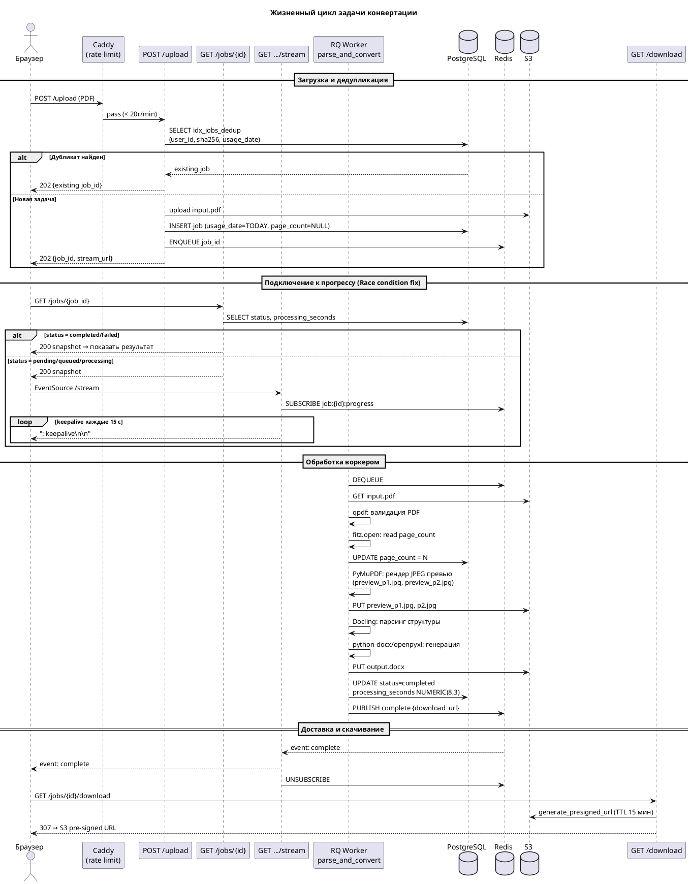
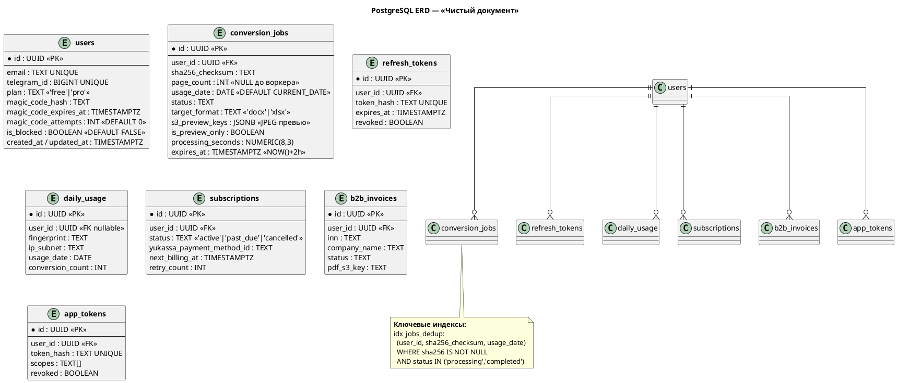
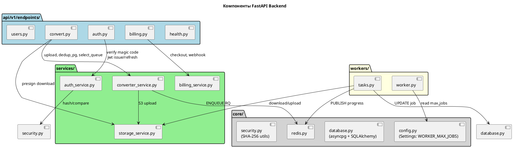

# ARCHITECTURE.md — Финальная архитектура «Чистый документ»

> **Версия:** v0.1
>
> **Дата:** 15 октября 2026 г.

---

## 1. Обзор системы (System Overview)

«Чистый документ» — B2B микро-SaaS для конвертации PDF → DOCX/XLSX с сохранением верстки,
развёртываемый на одном VDS под управлением Docker Compose.

**Ключевые характеристики:**

| Параметр | Значение |
| :--- | :--- |
| Целевая аудитория | B2B/SMB, РФ, соответствие 152-ФЗ |
| Доступ | Анонимный (лимит 2 стр./день) + Free (3 конв./день) + PRO |
| Хранение файлов | S3-совместимое (Selectel ru-1 в prod, MinIO в dev), TTL 2 ч |
| Авторизация | Passwordless: Email Magic Link (6-значный код) + Telegram Login Widget |
| Конвертация | Docling (IBM) + PyMuPDF + qpdf; превью JPEG через PyMuPDF |
| Мониторинг | Prometheus + Grafana; `/metrics` закрыт через Caddy |
| Соответствие | 152-ФЗ (серверы РФ, шифрование AES-256, удаление через 2 ч) |

---

## 2. Диаграмма высокого уровня (C4 Context)

```plantuml
@startuml C4_Context
!include https://raw.githubusercontent.com/plantuml-stdlib/C4-PlantUML/master/C4_Context.puml

LAYOUT_WITH_LEGEND()

title «Чистый документ» — C4 Context

Person(user_anon,   "Анонимный пользователь", "Конвертирует PDF без регистрации, лимит 2 стр./день")
Person(user_free,   "Free пользователь",       "Email/Telegram авторизация, 3 конв./день")
Person(user_pro,    "PRO пользователь",        "Подписка, без лимитов, приоритетная очередь")
Person(admin,       "Администратор",            "Telegram-алерты, ручная блокировка аккаунтов")

System(cleandoc,    "«Чистый документ»",        "Онлайн-конвертер PDF → DOCX/XLSX")

System_Ext(yukassa, "ЮKassa",                  "Платежный шлюз (карты, СБП)")
System_Ext(dadata,  "DaData",                  "Реестр юрлиц по ИНН для B2B-счетов")
System_Ext(telegram,"Telegram",                "Login Widget + Notification Bot")
System_Ext(smtp,    "SMTP (Mailhog/prod)",      "Отправка Magic Link на Email")
System_Ext(selectel,"Selectel S3 (ru-1)",      "Объектное хранилище файлов")

Rel(user_anon,  cleandoc, "Загружает PDF", "HTTPS")
Rel(user_free,  cleandoc, "Логин + конвертация", "HTTPS")
Rel(user_pro,   cleandoc, "Подписка + конвертация", "HTTPS")
Rel(admin,      telegram, "Получает алерты", "Telegram")

Rel(cleandoc, yukassa,  "Создание платежей, вебхуки", "HTTPS")
Rel(cleandoc, dadata,   "Поиск организации по ИНН", "HTTPS")
Rel(cleandoc, telegram, "Уведомления + вход", "Telegram Bot API")
Rel(cleandoc, smtp,     "Magic Link Email", "SMTP")
Rel(cleandoc, selectel, "Хранение файлов (AES-256)", "S3 API")

@enduml
```

---

## 3. Контейнерная архитектура (C4 Container)

```plantuml
@startuml C4_Containers
!include https://raw.githubusercontent.com/plantuml-stdlib/C4-PlantUML/master/C4_Container.puml

LAYOUT_TOP_DOWN()
LAYOUT_WITH_LEGEND()

title «Чистый документ» — C4 Containers (Production Docker Compose)

Person(browser, "Браузер пользователя")

System_Boundary(vds, "VDS — 8 ГБ RAM / 4 vCPU (Selectel, ru-1)") {
    Container(caddy,    "Caddy v2",           "Reverse proxy",    "TLS Let's Encrypt, rate limit 20r/m на upload,\nblocks /metrics снаружи (remote_ip 172.16.0.0/12)")
    Container(frontend, "Next.js 14",         "Node.js",          "App Router, Server Components, shadcn/ui")
    Container(api,      "FastAPI",            "Python 3.12",      "Async API: upload, SSE stream, auth, billing;\nslowapi rate limit; /auth 5 rq/h")
    Container(worker,   "RQ Worker",          "Python 3.12",      "Docling + PyMuPDF + qpdf;\nmem_limit 4g; max_jobs=WORKER_MAX_JOBS")
    ContainerDb(postgres, "PostgreSQL 18",    "RDBMS",            "Пользователи, задачи, биллинг;\nidx_jobs_dedup для дедупликации")
    ContainerDb(redis,  "Redis 7.2",          "In-Memory",        "Очереди RQ (priority/fast/heavy)\nPub/Sub: SSE-прогресс задач")
    Container(minio,    "MinIO",              "S3-совместимый",   "Только dev-контур; в prod — Selectel S3")
    Container(prometheus,"Prometheus",        "Metrics scraper",  "Сбор метрик FastAPI (internal only)")
    Container(grafana,  "Grafana",            "Dashboards",       "Визуализация метрик")
}

System_Ext(selectelS3, "Selectel S3 (ru-1)", "Prod-хранилище файлов")

Rel(browser,    caddy,      "HTTPS/443")
Rel(caddy,      frontend,   "HTTP/3000")
Rel(caddy,      api,        "HTTP/8000")

Rel(api,        postgres,   "asyncpg (SQLAlchemy 2.0)")
Rel(api,        redis,      "aioredis: enqueue RQ + Pub/Sub SSE")
Rel(api,        selectelS3, "aioboto3: upload/presign")
Rel(worker,     postgres,   "asyncpg: update job status")
Rel(worker,     redis,      "RQ dequeue + PUBLISH progress")
Rel(worker,     selectelS3, "aioboto3: download input / upload result")
Rel(prometheus, api,        "Scrape /metrics (Docker internal only)")
Rel(grafana,    prometheus, "PromQL dashboards")

@enduml
```

---

## 4. Диаграмма последовательности: конвертация PDF



---

## 5. Диаграмма схемы БД (ERD)



---

## 6. Компоненты бэкенда



---

## 7. System Design: расчёты ресурсов

### 7.1. Целевые метрики MVP

| Метрика | Значение | Комментарий |
| :--- | :--- | :--- |
| Одновременных пользователей | ~50 | MVP/early access |
| Конвертаций в час (пик) | ~30 | при 3 конв./день на Free |
| Макс. размер файла (Free) | 10 МБ | ~200 страниц A4 |
| Макс. размер файла (PRO) | 100 МБ | ~2000 страниц |
| Время конвертации (p95) | < 60 с | текстовые PDF |
| Время конвертации (таймаут) | 180 с | жёсткий RQ job_timeout |
| Хранение файла | 2 ч | S3 lifecycle policy |

### 7.2. Оценка нагрузки

```text
Пиковый трафик  : 50 пользователей × 10 req/сессию = 500 req/ч ≈ 0.14 req/с
Upload endpoint : Caddy 20 req/min/IP + slowapi 10 req/min/IP
SSE connections : до 500 одновременных (asyncio coroutine ≈ 50 КБ RAM)
Очередь RQ      : 1 воркер × 1 задача одновременно (sequential ML pipeline)
Дедупликация    : idx_jobs_dedup исключает повторную обработку одного PDF в сутки
```

### 7.3. Требования к VDS

| Ресурс | Минимум | Рекомендуемое | Обоснование |
| :--- | :--- | :--- | :--- |
| **CPU** | 4 vCPU | 4–8 vCPU | Docling однопоточно; FastAPI async |
| **RAM** | 8 ГБ | 10–12 ГБ | Worker: 4 ГБ + прочие сервисы ~3–4 ГБ |
| **SSD** | 80 ГБ | 100 ГБ | Docker образы (~15 ГБ Docling) + логи + temp |
| **Сеть** | 100 Мбит/с | 100 Мбит/с | Загрузка/скачивание файлов ↔ S3 |

**Распределение RAM при пике:**

```
PostgreSQL      : ~512 МБ
Redis           : ~128 МБ
FastAPI (API)   : ~256 МБ
Next.js         : ~256 МБ
RQ Worker       : до 4 096 МБ (mem_limit: 4g)
Prometheus      : ~128 МБ
Grafana         : ~128 МБ
ОС + буферы     : ~512 МБ
─────────────────────────
ИТОГО (пик)     : ~5.9 ГБ
ЗАПАС (10–12 ГБ): ~4–6 ГБ
```

### 7.4. Масштабирование (Post-MVP)

1. **Горизонтально:** 2–3 RQ Worker реплики; очередь `heavy` выносится отдельно.
2. **Вертикально:** VDS 16 ГБ RAM / 8 vCPU.
3. **CDN:** Selectel CDN для статики Next.js.
4. **PgBouncer:** при > 200 одновременных API-запросов.

---

## 8. Карта API-эндпоинтов

| Метод | Путь | Описание | Rate Limit |
| :--- | :--- | :--- | :--- |
| `GET` | `/api/v1/health` | Liveness probe | — |
| `GET` | `/api/v1/ready` | Readiness probe | — |
| `POST` | `/api/v1/auth/magic-link` | Запрос Magic Link | 3 req/мин/IP |
| `POST` | `/api/v1/auth/verify-code` | Подтверждение кода | **5 req/ч/IP** |
| `POST` | `/api/v1/auth/telegram` | Вход через Telegram | 10 req/мин/IP |
| `POST` | `/api/v1/auth/refresh` | Обновление JWT | 30 req/мин |
| `POST` | `/api/v1/auth/logout` | Выход | — |
| `GET` | `/api/v1/auth/me` | Профиль | — |
| `POST` | `/api/v1/convert/upload` | **Загрузка PDF** | **Caddy: 20r/m; slowapi: 10r/m** |
| `GET` | `/api/v1/convert/jobs/{id}` | Снапшот статуса | — |
| `GET` | `/api/v1/convert/jobs/{id}/stream` | SSE прогресс (+ keepalive 15 с) | — |
| `GET` | `/api/v1/convert/jobs/{id}/download` | Скачивание → S3 pre-signed | — |
| `GET` | `/api/v1/users/me/conversions` | История за сутки | — |
| `POST` | `/api/v1/billing/create-checkout` | Платеж ЮKassa | — |
| `POST` | `/api/v1/billing/webhook/yukassa` | Вебхук ЮKassa | — |
| `POST` | `/api/v1/billing/invoices/create` | B2B счет по ИНН | — |
| `GET` | `/api/v1/billing/invoices/{id}/pdf` | PDF счета | — |
| `POST` | `/api/v1/billing/cancel-subscription` | Отмена подписки | — |

---

## 9. Сводная таблица мер безопасности

| Угроза | Мера защиты | Слой |
| :--- | :--- | :--- |
| Брутфорс Magic Link | 5 req/ч/IP + `magic_code_attempts` → инвалидация кода | slowapi + PostgreSQL |
| DDoS на upload | Caddy 20r/m/IP + slowapi 10r/m/IP | Caddy + FastAPI |
| Утечка метрик | `/metrics` только `172.16.0.0/12` внутри Docker | Caddyfile |
| SQL Injection | SQLAlchemy ORM; f-строки в SQL запрещены | SQLAlchemy |
| Несанкционированный доступ к файлам | `session_token_hash` (аноним) / JWT (авторизован) | FastAPI auth |
| Replay attack Magic Link | Одноразовый код: `magic_code_hash = NULL` после использования | PostgreSQL |
| Утечка ПД в логах | Только UUID + байты + время; текст/имена запрещены | structlog |
| Хранение секретов | `.env`-only; `.env` в `.gitignore` | AGENTS.md |
| Файлы без шифрования | `ServerSideEncryption='AES256'` на каждом S3 upload | storage_service |
| Хранение ПД дольше нормы | S3 Lifecycle `temp/*` → удаление через 2 ч | Selectel S3 |

---

## 10. Связанные документы

| Документ | Путь |
| :--- | :--- |
| **TECH.md** (SSOT) | [`docs/TECH.md`](./TECH.md) |
| **AGENTS.md** | [`AGENTS.md`](../AGENTS.md) |
| **SLICE-00.md** | [`docs/SLICE-00.md`](./SLICE-00.md) |
| **SLICE-01.md** | [`docs/SLICE-01.md`](./SLICE-01.md) |
