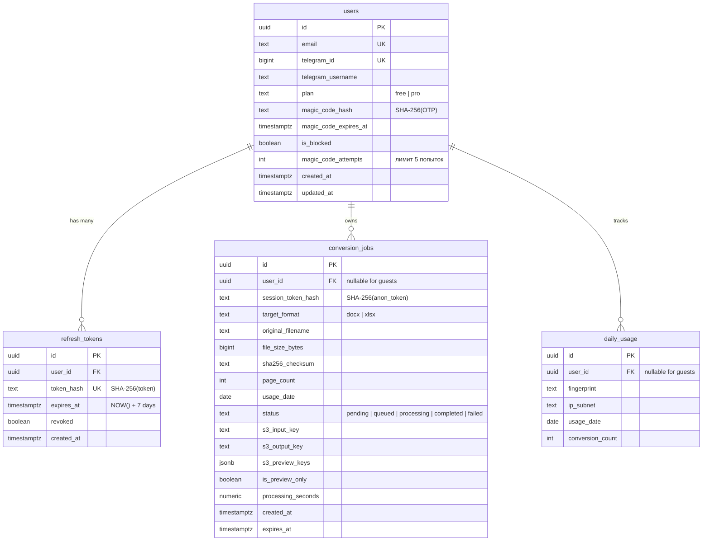
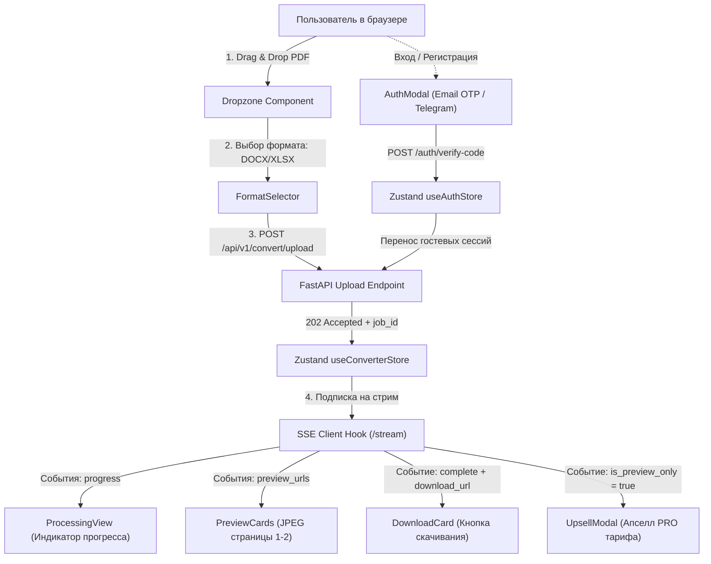

# SLICE-02: Auth & UX — Детальная спецификация реализации и инженерный харнес

> **Статус:** Действующий / Ready for Implementation  
> **Версия:** v0.1
> **Дата:** 15 октября 2026 г.  
> **Спринт:** 3 (Дни 29–42)  
> **Зависимости:** Slice 0 (Foundation), Slice 1 (Processing)  
> **Единый источник технической правды:** [`docs/TECH.md`](./TECH.md)  
> **Операционный регламент:** [`AGENTS.md`](../AGENTS.md)  

---

## 0. Цель и Definition of Done (DoD)

**Цель Slice 2:** реализовать полноценный клиентский веб-интерфейс на Next.js 14 для онлайн-конвертера PDF в Word и Excel с поддержкой интерактивного Drag & Drop, отображением потокового прогресса конвертации в реальном времени по протоколу SSE, отрисовкой JPEG-превью первых двух страниц документа, модальным окном апселла для многостраничных документов, модулем беспарольной аутентификации (Email Magic Link / 6-значный OTP код + Telegram Login Widget), сквозным связыванием анонимных сессий (Anonymous Claiming), а также подготовить контейнеризированное окружение с боевыми весами ML-моделей Docling 2.0 в Docker для локального тестирования полного цикла продукта в браузере.

### Definition of Done (DoD)

- [ ] В `backend/pyproject.toml` зафиксированы зависимости `docling>=2.0.0` и `aiosmtplib>=3.0.0`, файл блокировок `uv.lock` синхронизирован.
- [ ] Сервис `backend/Dockerfile.worker` сконфигурирован для предзагрузки и персистентного хранения артефактов моделей Docling (`DOCLING_ARTIFACTS_PATH=/app/.docling`, `HF_HOME=/app/.cache/huggingface`) с выносом в именованный Docker volume.
- [ ] Воркер `backend/app/workers/worker.py` при старте выполняет успешный прогрев (warmup) движка Docling на эталонном PDF без ошибок и падений.
- [ ] Реализован сервис почтовой доставки `backend/app/services/email_service.py` с асинхронной отправкой HTML и plain-text писем с 6-значным числовым кодом и кликабельной Magic Link ссылкой (в dev-среде письма перехватываются Mailhog).
- [ ] Реализован сервис аутентификации `backend/app/services/auth_service.py`:
  - генерация криптографически стойкого 6-значного OTP (`secrets.randbelow(1000000)`);
  - хеширование кода через SHA-256 с временем жизни (TTL) 15 минут в таблице `users`;
  - валидация подписи Telegram Login Widget по спецификации (HMAC-SHA256 от токена бота);
  - выдача JWT access токена (TTL 15 минут) и случайного криптографического refresh токена (TTL 7 дней) с записью SHA-256 хеша в `refresh_tokens`;
  - ротация и отзыв refresh токенов при выходе и обновлении сессии;
  - сквозное связывание гостевых конвертаций (`UPDATE conversion_jobs SET user_id = :uid WHERE session_token_hash = :hash`).
- [ ] Реализованы эндпоинты аутентификации в `backend/app/api/v1/endpoints/auth.py`:
  - `POST /api/v1/auth/magic-link` (rate limit `slowapi` 5 запросов в час по IP);
  - `POST /api/v1/auth/verify-code` (rate limit 5 запросов в час, защита от подбора: блокировка после 5 неудачных попыток, выставление HttpOnly cookie `refresh_token`);
  - `POST /api/v1/auth/telegram` (валидация виджета, выставление HttpOnly cookie);
  - `POST /api/v1/auth/refresh` (ротация refresh токена, выдача нового access токена);
  - `POST /api/v1/auth/logout` (отзыв токена в БД, очистка cookie);
  - `GET /api/v1/auth/me` (получение профиля, тарифа и остатка суточных конвертаций).
- [ ] Реализованы зависимости FastAPI `get_current_user` и `get_optional_user` в `backend/app/core/security.py`.
- [ ] Создан многоэтапный `frontend/Dockerfile` для сборки и запуска приложения Next.js 14 в Docker.
- [ ] Манифест `deploy/docker-compose.yml` расширен сервисом `frontend` (порт 3000) и именованным томом `docling_models`.
- [ ] Разработан клиентский интерфейс конвертера на Next.js 14 (App Router, Tailwind CSS, `shadcn/ui`, `lucide-react`):
  - компонент `Dropzone` с поддержкой перетаскивания PDF, валидацией Magic Bytes и лимитов размера (10 МБ Free / 100 МБ PRO);
  - селектор формата конвертации: Word (`.docx`) или Excel (`.xlsx`);
  - экран обработки с интерактивным прогресс-баром, процентами и текстовым статусом шагов из SSE-стрима;
  - компонент `PreviewCards` для отображения сгенерированных воркером JPEG-превью страниц 1–2;
  - карточка скачивания готового результата по временному pre-signed URL;
  - модальное окно перехода на тариф PRO при `is_preview_only = True` (`UPGRADE_REQUIRED`);
  - модальное окно беспарольного входа (Email OTP + Telegram Login Widget);
  - шапка сайта с индикатором текущего тарифа, счетчиком суточных конвертаций и кнопкой авторизации.
- [ ] Реализованы клиентские хранилища Zustand:
  - `frontend/src/store/useConverterStore.ts` (состояние загрузки, задачи, SSE-стрима и превью);
  - `frontend/src/store/useAuthStore.ts` (состояние авторизации, JWT access токен в памяти, профиль пользователя).
- [ ] Написаны юнит- и интеграционные тесты бэкенда в `backend/tests/test_auth.py` (покрытие логики авторизации и лимитов не менее 85%).
- [ ] Написаны компонентные тесты фронтенда в `frontend/src/` с использованием Vitest и `@testing-library/react`.
- [ ] Все статические проверки, линтеры и тесты пайплайна `make gate` завершаются с кодом `0`.
- [ ] Выполнен ручной сквозной сценарий тестирования в браузере: загрузка PDF $\to$ фоновая обработка воркером с реальным Docling $\to$ отображение превью $\to$ скачивание готового файла.

---

## 1. Архитектурная структура файлов и модулей (Slice 2)

В рамках Slice 2 создаются и модифицируются следующие файлы монорепозитория:

```text
clean-doc/
  backend/
    app/
      api/
        v1/
          endpoints/
            auth.py                   # HTTP контроллеры: magic-link, verify-code, telegram, refresh, logout, me
            convert.py                # Подключение зависимостей авторизации и optional user
          router.py                   # Подключение auth.router в единое дерево API v1
      core/
        config.py                     # Переменные TELEGRAM_BOT_TOKEN, JWT TTL, SMTP параметры
        security.py                   # Зависимости get_current_user, get_optional_user, генерация JWT
      models/
        user.py                       # Модель User (поля OTP, счетчик попыток, статус блокировки)
        token.py                      # Модель RefreshToken
      schemas/
        __init__.py                   # Экспорт DTO схем аутентификации
        auth.py                       # Pydantic v2 схемы: MagicLinkRequest, VerifyCodeRequest, TelegramAuth, TokenResponse
        user.py                       # Pydantic v2 схемы профиля пользователя и остатка лимитов
      services/
        __init__.py                   # Экспорт сервисов
        auth_service.py               # Бизнес-логика беспарольного входа, ротации токенов и claiming сессий
        email_service.py              # Асинхронный почтовый транспорт (aiosmtplib + HTML шаблоны)
      workers/
        worker.py                     # Разогрев Docling с сохранением артефактов в persistent volume
        tasks.py                      # Парсинг документов и выгрузка превью
    Dockerfile.worker                 # Конфигурация кеша весов Docling и системных библиотек
    pyproject.toml                    # Добавление зависимостей docling, aiosmtplib, python-jose
    tests/
      conftest.py                     # Фикстуры авторизованных клиентов и тестовых JWT
      test_auth.py                    # Юнит- и интеграционные тесты модуля аутентификации
  frontend/
    Dockerfile                        # Multi-stage Dockerfile для сборки и запуска Next.js 14
    src/
      app/
        layout.tsx                    # Корневой лэйаут с QueryClientProvider и инициализацией Auth
        page.tsx                      # Главная страница: интеграция конвертера, превью и модалок
        globals.css                   # Стили Tailwind CSS и анимации индикаторов прогресса
      components/
        auth/
          AuthModal.tsx               # Диалоговое окно авторизации (Email OTP / Telegram)
          EmailOtpForm.tsx            # Форма ввода Email и 6-значного числового кода
          TelegramLoginButton.tsx     # Обвязка официального Telegram Login Widget
        converter/
          Dropzone.tsx                # Drag & Drop контейнер загрузки PDF с валидацией
          FormatSelector.tsx          # Переключатель целевого формата (DOCX / XLSX)
          ProcessingView.tsx          # Индикатор прогресса конвертации на базе SSE
          PreviewCards.tsx            # Галерея JPEG-превью страниц 1–2
          DownloadCard.tsx            # Кнопка получения файла по pre-signed URL
          UpsellModal.tsx             # Модальное окно перехода на тариф PRO при multi-page
        layout/
          Header.tsx                  # Шапка сайта: логотип, баланс суточных конвертаций, профиль
          Footer.tsx                  # Подвал: дисклеймер 152-ФЗ, ссылки на оферту и поддержку
      lib/
        api-client.ts                 # Расширение клиента поддержкой интерцептора 401 и refresh token
        sse-client.ts                 # Хук управления SSE подпиской с автоматическим polling fallback
        types.ts                      # Единые интерфейсы TypeScript для задач, событий и пользователя
      store/
        useAuthStore.ts               # Состояние аутентификации (access JWT в памяти, User профиль)
        useConverterStore.ts          # Состояние жизненного цикла конвертации и превью
  deploy/
    docker-compose.yml                # Добавление сервиса frontend (порт 3000) и volume docling_models
  docs/
    SLICE-02.md                       # Настоящий документ спецификации
```

---

## 2. Модели данных и база данных (Схемы аутентификации и сессий)

Для реализации функциональности Slice 2 используются существующие таблицы базы данных PostgreSQL 18, созданные в миграциях `0001_initial_schema.py` и `0002_conversion_jobs.py`.



### 2.1. Механизм сквозного связывания гостевых сессий (Anonymous Claiming)

При анонимной конвертации задача фиксируется с `user_id = NULL` и сохраняет хеш сессии `session_token_hash` из cookie `anon_session`.
В момент подтверждения кода авторизации (`POST /auth/verify-code` или `POST /auth/telegram`) сервис аутентификации выполняет атомарный перенос всех недавних задач гостя в профиль авторизованного пользователя:

```sql
UPDATE conversion_jobs
SET user_id = :authenticated_user_id
WHERE session_token_hash = :anon_session_token_hash
  AND user_id IS NULL;
```

Это исключает потерю результатов конвертации при переходе от гостевого статуса к зарегистрированному аккаунту.

---

## 3. Контракты данных и Pydantic схемы (`backend/app/schemas/auth.py`)

### 3.1. Запросы и ответы модуля аутентификации

```python
from datetime import datetime
from uuid import UUID
from pydantic import BaseModel, EmailStr, Field


class MagicLinkRequest(BaseModel):
    """Запрос на отправку 6-значного кода и ссылки на email."""
    email: EmailStr = Field(..., description="Электронная почта пользователя")


class MagicLinkResponse(BaseModel):
    """Подтверждение отправки письма."""
    message: str = Field(
        default="Одноразовый код успешно отправлен на указанную почту",
        description="Информационное сообщение для пользователя",
    )
    email: EmailStr
    expires_in_seconds: int = Field(default=900, description="Время жизни кода в секундах")


class VerifyCodeRequest(BaseModel):
    """Подтверждение 6-значного OTP-кода или токена ссылки."""
    email: EmailStr = Field(..., description="Электронная почта пользователя")
    code: str = Field(
        ...,
        min_length=6,
        max_length=6,
        pattern=r"^\d{6}$",
        description="6-значный цифровой код из письма",
    )


class TelegramAuthRequest(BaseModel):
    """Данные авторизации от официального Telegram Login Widget."""
    id: int = Field(..., description="Идентификатор пользователя в Telegram")
    first_name: str | None = Field(default=None, description="Имя пользователя")
    last_name: str | None = Field(default=None, description="Фамилия пользователя")
    username: str | None = Field(default=None, description="Юзернейм в Telegram")
    photo_url: str | None = Field(default=None, description="Аватар пользователя")
    auth_date: int = Field(..., description="UNIX timestamp момента авторизации")
    hash: str = Field(..., description="HMAC-SHA256 подпись параметров виджета")


class AuthTokenResponse(BaseModel):
    """Ответ успешной аутентификации с JWT access-токеном."""
    access_token: str = Field(..., description="JWT Bearer access token")
    token_type: str = Field(default="bearer", description="Тип авторизационного токена")
    expires_in: int = Field(default=900, description="Срок жизни токена в секундах (15 минут)")


class UserProfileResponse(BaseModel):
    """Профиль текущего пользователя и состояние лимитов тарифа."""
    id: UUID
    email: str | None = None
    telegram_username: str | None = None
    plan: str = Field(..., description="Текущий тарифный план: free или pro")
    conversions_today: int = Field(..., description="Количество использованных конвертаций сегодня")
    conversions_limit: int = Field(..., description="Дневной лимит конвертаций: 3 для Free, 500 для PRO")
    is_blocked: bool
    created_at: datetime
```

---

## 4. Сервисный слой аутентификации и почты

### 4.1. Почтовый сервис: `backend/app/services/email_service.py`

Сервис осуществляет асинхронную доставку транзакционных писем через протокол SMTP с использованием библиотеки `aiosmtplib`. В локальном окружении письма направляются в контейнер `cleandoc_mailhog` (порт `1025`), веб-интерфейс которого доступен по адресу `http://localhost:8025`.

```python
import structlog
from email.message import EmailMessage
import aiosmtplib

from app.core.config import get_settings

logger = structlog.get_logger()
settings = get_settings()


class EmailService:
    async def send_magic_code(self, to_email: str, code: str, magic_link_url: str) -> None:
        """Отправляет транзакционное письмо с кодом и ссылкой входа."""
        msg = EmailMessage()
        msg["Subject"] = f"{code} — ваш код для входа в сервис «Чистый документ»"
        msg["From"] = settings.SMTP_FROM_EMAIL
        msg["To"] = to_email

        plain_text = (
            f"Здравствуйте!\n\n"
            f"Ваш одноразовый код для входа в сервис «Чистый документ»: {code}\n"
            f"Код действителен в течение 15 минут.\n\n"
            f"Или перейдите по прямой ссылке для быстрого входа:\n"
            f"{magic_link_url}\n\n"
            f"Если вы не запрашивали этот код, просто проигнорируйте письмо."
        )

        html_text = f"""
        <!DOCTYPE html>
        <html>
        <head><meta charset="utf-8"></head>
        <body style="font-family: -apple-system, BlinkMacSystemFont, 'Segoe UI', Roboto, Helvetica, Arial, sans-serif; background-color: #f8fafc; padding: 24px;">
          <div style="max-width: 520px; margin: 0 auto; background-color: #ffffff; border-radius: 12px; border: 1px solid #e2e8f0; padding: 32px; box-shadow: 0 4px 6px -1px rgba(0,0,0,0.05);">
            <h2 style="color: #0f172a; margin-top: 0; font-size: 22px;">Вход в «Чистый документ»</h2>
            <p style="color: #475569; font-size: 15px; line-height: 1.5;">Используйте данный код для входа в сервис и управления вашими документами:</p>
            <div style="background-color: #f1f5f9; border-radius: 8px; padding: 18px; text-align: center; margin: 24px 0;">
              <span style="font-size: 32px; font-weight: 700; letter-spacing: 6px; color: #2563eb;">{code}</span>
            </div>
            <p style="color: #64748b; font-size: 13px; text-align: center;">Код действует 15 минут. Никому его не сообщайте.</p>
            <div style="text-align: center; margin-top: 24px;">
              <a href="{magic_link_url}" style="display: inline-block; background-color: #2563eb; color: #ffffff; text-decoration: none; padding: 12px 24px; border-radius: 8px; font-weight: 500; font-size: 14px;">Войти в один клик</a>
            </div>
          </div>
        </body>
        </html>
        """

        msg.set_content(plain_text)
        msg.add_alternative(html_text, subtype="html")

        logger.info("email_sending_started", to_domain=to_email.split("@")[-1])

        await aiosmtplib.send(
            msg,
            hostname=settings.SMTP_HOST,
            port=settings.SMTP_PORT,
            use_tls=settings.SMTP_USE_TLS,
            username=settings.SMTP_USER if settings.SMTP_USER else None,
            password=settings.SMTP_PASSWORD if settings.SMTP_PASSWORD else None,
        )
        logger.info("email_sending_success")


email_service = EmailService()
```

### 4.2. Сервис аутентификации: `backend/app/services/auth_service.py`

Реализует генерацию случайных криптографических 6-значных последовательностей через `secrets`, расчет SHA-256 хеша, проверку HMAC-SHA256 подписи Telegram виджета, выпуск JWT токенов и ротацию записей в таблице `refresh_tokens`.

```python
import hashlib
import hmac
import secrets
from datetime import datetime, timedelta, timezone
from uuid import UUID

import structlog
from fastapi import HTTPException, status
from jose import jwt
from sqlalchemy import func, select, update
from sqlalchemy.ext.asyncio import AsyncSession

from app.core.config import get_settings
from app.models.job import ConversionJob
from app.models.token import RefreshToken
from app.models.usage import DailyUsage
from app.models.user import User
from app.schemas.auth import TelegramAuthRequest
from app.services.email_service import email_service

logger = structlog.get_logger()
settings = get_settings()


class AuthService:
    def hash_token(self, raw_token: str) -> str:
        """Хеширует токен или код алгоритмом SHA-256."""
        return hashlib.sha256(raw_token.encode("utf-8")).hexdigest()

    def generate_jwt_access_token(self, user_id: UUID) -> tuple[str, int]:
        """Генерирует короткоживущий JWT access-токен (15 минут)."""
        expires_delta = timedelta(minutes=15)
        expire_at = datetime.now(timezone.utc) + expires_delta
        payload = {
            "sub": str(user_id),
            "exp": expire_at,
            "iat": datetime.now(timezone.utc),
            "type": "access",
        }
        token = jwt.encode(payload, settings.SECRET_KEY, algorithm="HS256")
        return token, int(expires_delta.total_seconds())

    async def create_magic_code(self, db: AsyncSession, email: str) -> None:
        """Генерирует 6-значный OTP, сохраняет его хеш и отправляет письмо."""
        email_clean = email.lower().strip()
        user = await db.scalar(select(User).where(User.email == email_clean))
        if not user:
            user = User(email=email_clean, plan="free")
            db.add(user)
            await db.flush()

        if user.is_blocked:
            raise HTTPException(
                status_code=status.HTTP_403_FORBIDDEN,
                detail={"error": "Учетная запись заблокирована", "code": "USER_BLOCKED"},
            )

        raw_code = f"{secrets.randbelow(1000000):06d}"
        code_hash = self.hash_token(raw_code)
        expires_at = datetime.now(timezone.utc) + timedelta(minutes=15)

        user.magic_code_hash = code_hash
        user.magic_code_expires_at = expires_at
        user.magic_code_attempts = 0
        await db.commit()

        magic_link_url = f"{settings.FRONTEND_URL}/auth/verify?email={email_clean}&code={raw_code}"
        await email_service.send_magic_code(email_clean, raw_code, magic_link_url)

    async def verify_magic_code(
        self, db: AsyncSession, email: str, raw_code: str, anon_session_raw: str | None = None
    ) -> tuple[User, str, str]:
        """
        Проверяет код, возвращает кортеж (User, access_token, raw_refresh_token).
        При наличии anon_session_raw выполняет связывание гостевых конвертаций.
        """
        email_clean = email.lower().strip()
        user = await db.scalar(select(User).where(User.email == email_clean))
        if not user or not user.magic_code_hash or not user.magic_code_expires_at:
            raise HTTPException(
                status_code=status.HTTP_400_BAD_REQUEST,
                detail={"error": "Код не запрашивался или устарел", "code": "INVALID_CODE"},
            )

        if user.is_blocked:
            raise HTTPException(
                status_code=status.HTTP_403_FORBIDDEN,
                detail={"error": "Учетная запись заблокирована", "code": "USER_BLOCKED"},
            )

        # Защита от брутфорса: максимум 5 попыток ввода
        if user.magic_code_attempts >= 5:
            user.magic_code_hash = None
            user.magic_code_expires_at = None
            await db.commit()
            raise HTTPException(
                status_code=status.HTTP_429_TOO_MANY_REQUESTS,
                detail={"error": "Превышено количество попыток. Запросите новый код.", "code": "MAX_ATTEMPTS_EXCEEDED"},
            )

        now_utc = datetime.now(timezone.utc)
        if now_utc > user.magic_code_expires_at:
            raise HTTPException(
                status_code=status.HTTP_400_BAD_REQUEST,
                detail={"error": "Срок действия кода истек", "code": "CODE_EXPIRED"},
            )

        candidate_hash = self.hash_token(raw_code)
        if not hmac.compare_digest(candidate_hash, user.magic_code_hash):
            user.magic_code_attempts += 1
            await db.commit()
            raise HTTPException(
                status_code=status.HTTP_400_BAD_REQUEST,
                detail={"error": "Неверный код подтверждения", "code": "INVALID_CODE"},
            )

        # Сброс кода после успешной проверки
        user.magic_code_hash = None
        user.magic_code_expires_at = None
        user.magic_code_attempts = 0

        # Выпуск JWT access токена и Refresh токена
        access_token, _ = self.generate_jwt_access_token(user.id)
        raw_refresh = secrets.token_urlsafe(48)
        refresh_hash = self.hash_token(raw_refresh)

        token_record = RefreshToken(
            user_id=user.id,
            token_hash=refresh_hash,
            expires_at=datetime.now(timezone.utc) + timedelta(days=7),
        )
        db.add(token_record)

        # Выполнение связывания сессии анонимного гостя (Anonymous Claiming)
        if anon_session_raw:
            anon_hash = self.hash_token(anon_session_raw)
            await db.execute(
                update(ConversionJob)
                .where(ConversionJob.session_token_hash == anon_hash)
                .where(ConversionJob.user_id.is_(None))
                .values(user_id=user.id)
            )

        await db.commit()
        return user, access_token, raw_refresh

    def verify_telegram_data(self, data: TelegramAuthRequest) -> bool:
        """Проверяет криптографическую валидность HMAC-SHA256 подписи Telegram виджета."""
        if not settings.TELEGRAM_BOT_TOKEN:
            return False

        secret_key = hashlib.sha256(settings.TELEGRAM_BOT_TOKEN.encode("utf-8")).digest()
        data_dict = data.model_dump(exclude={"hash"}, exclude_none=True)
        sorted_pairs = [f"{k}={v}" for k, v in sorted(data_dict.items())]
        data_check_string = "\n".join(sorted_pairs)

        calculated_hash = hmac.new(
            secret_key, data_check_string.encode("utf-8"), hashlib.sha256
        ).hexdigest()

        return hmac.compare_digest(calculated_hash, data.hash)


auth_service = AuthService()
```

---

## 5. HTTP контроллеры API v1 Auth (`backend/app/api/v1/endpoints/auth.py`)

Модуль предоставляет маршруты аутентификации с соблюдением требований 152-ФЗ и установкой защищенных `HttpOnly` cookie.

```python
from datetime import date
from typing import Annotated
from fastapi import APIRouter, Cookie, Depends, HTTPException, Request, Response, status
from sqlalchemy import func, select
from sqlalchemy.ext.asyncio import AsyncSession

from app.core.config import get_settings
from app.core.database import get_db
from app.core.security import get_current_user
from app.models.token import RefreshToken
from app.models.usage import DailyUsage
from app.models.user import User
from app.schemas.auth import (
    AuthTokenResponse,
    MagicLinkRequest,
    MagicLinkResponse,
    TelegramAuthRequest,
    UserProfileResponse,
    VerifyCodeRequest,
)
from app.services.auth_service import auth_service

router = APIRouter(prefix="/auth", tags=["Аутентификация"])
settings = get_settings()


@router.post("/magic-link", response_model=MagicLinkResponse)
async def request_magic_link(
    request: Request,
    body: MagicLinkRequest,
    db: AsyncSession = Depends(get_db),
) -> MagicLinkResponse:
    """Запрос отправки 6-значного OTP кода и прямой ссылки на email."""
    await auth_service.create_magic_code(db, body.email)
    return MagicLinkResponse(email=body.email)


@router.post("/verify-code", response_model=AuthTokenResponse)
async def verify_code(
    body: VerifyCodeRequest,
    response: Response,
    db: AsyncSession = Depends(get_db),
    anon_session: Annotated[str | None, Cookie()] = None,
) -> AuthTokenResponse:
    """Проверка 6-значного кода, выдача access JWT и установка refresh cookie."""
    user, access_token, raw_refresh = await auth_service.verify_magic_code(
        db, body.email, body.code, anon_session_raw=anon_session
    )

    # Установка безопасной HttpOnly Cookie с временем жизни 7 дней
    response.set_cookie(
        key="refresh_token",
        value=raw_refresh,
        httponly=True,
        secure=settings.ENVIRONMENT == "prod",
        samesite="lax",
        max_age=7 * 24 * 3600,
        path="/api/v1/auth",
    )

    return AuthTokenResponse(access_token=access_token)


@router.get("/me", response_model=UserProfileResponse)
async def get_current_user_profile(
    current_user: User = Depends(get_current_user),
    db: AsyncSession = Depends(get_db),
) -> UserProfileResponse:
    """Получение профиля авторизованного пользователя и остатка дневных конвертаций."""
    today = date.today()
    usage = await db.scalar(
        select(DailyUsage.conversion_count)
        .where(DailyUsage.user_id == current_user.id)
        .where(DailyUsage.usage_date == today)
    )
    conversions_today = usage if usage else 0
    limit = 500 if current_user.plan == "pro" else 3

    return UserProfileResponse(
        id=current_user.id,
        email=current_user.email,
        telegram_username=current_user.telegram_username,
        plan=current_user.plan,
        conversions_today=conversions_today,
        conversions_limit=limit,
        is_blocked=current_user.is_blocked,
        created_at=current_user.created_at,
    )
```

---

## 6. Воркер и развертывание весов Docling в Docker (`Dockerfile.worker`, volume моделей, прогрев)

Для гарантированной работы конвертера с сохранением сложной верстки таблиц в воркер интегрируется полнофункциональный движок **Docling 2.0+**. Чтобы исключить повторное скачивание ML-моделей (Docling Layout, TableFormer, EasyOCR) при каждом перезапуске контейнера, настраивается персистентный Docker Volume `docling_models`.

### 6.1. Спецификация обновленного `backend/Dockerfile.worker`

```dockerfile
FROM python:3.12-slim-bookworm

ENV PYTHONUNBUFFERED=1 \
    PYTHONDONTWRITEBYTECODE=1 \
    UV_SYSTEM_PYTHON=1 \
    DOCLING_ARTIFACTS_PATH=/app/.docling \
    HF_HOME=/app/.cache/huggingface \
    HUGGINGFACE_HUB_VERBOSITY=error

WORKDIR /app

# Системные пакеты: qpdf для валидации, Tesseract OCR для русско-английских сканов, OpenGL
RUN apt-get update && apt-get install -y --no-install-recommends \
    curl \
    qpdf \
    libgl1 \
    libglib2.0-0 \
    tesseract-ocr \
    tesseract-ocr-rus \
    tesseract-ocr-eng \
    fonts-dejavu-core \
    && rm -rf /var/lib/apt/lists/*

COPY --from=ghcr.io/astral-sh/uv:0.4.18 /uv /bin/uv

# Установка зависимостей проекта и Docling 2.0 с оптимизацией CPU wheels
COPY pyproject.toml uv.lock ./
RUN uv pip install --no-cache docling>=2.0.0
RUN uv sync --frozen --no-install-project

COPY . .

# Создание директорий для хранения весов моделей
RUN mkdir -p /app/.docling /app/.cache/huggingface && chmod -R 777 /app/.docling /app/.cache

CMD ["python", "-m", "app.workers.worker"]
```

### 6.2. Превентивный разогрев воркера (`backend/app/workers/worker.py`)

При старте контейнера воркер инициализирует `DocumentConverter()` и прогоняет минимальный 1-страничный PDF-файл. При первом запуске необходимые веса загружаются в директорию тома, а последующие запуски стартуют в полностью автономном режиме:

```python
def _warmup_docling() -> None:
    """Превентивный прогрев моделей Docling перед приемом реальных клиентских задач."""
    logger.info("worker_warmup_docling_started", artifacts_path=settings.DOCLING_ARTIFACTS_PATH)
    try:
        from docling.document_converter import DocumentConverter

        pdf_bytes = base64.b64decode(_WARMUP_PDF_B64)
        with tempfile.NamedTemporaryFile(suffix=".pdf", delete=False) as f:
            f.write(pdf_bytes)
            f.flush()
            temp_path = f.name

        converter = DocumentConverter()
        converter.convert(temp_path)
        if os.path.exists(temp_path):
            os.remove(temp_path)
        logger.info("worker_warmup_docling_completed")
    except Exception as exc:
        logger.error("worker_warmup_docling_failed", error=str(exc))
        raise exc
```

---

## 7. Архитектура клиентского приложения (Frontend Next.js 14 App Router)

Клиентское приложение построено по компонентной архитектуре с жестким разделением серверного рендеринга (Server Components) и интерактивных клиентских контролов (`'use client'`).



### 7.1. Типы TypeScript: `frontend/src/lib/types.ts`

```typescript
export type TargetFormat = 'docx' | 'xlsx';
export type JobStatus = 'pending' | 'queued' | 'processing' | 'completed' | 'failed';

export interface SSEProgressPayload {
  job_id: string;
  status: JobStatus;
  progress_percent: number;
  current_step: string;
  page_current?: number;
  page_total?: number;
  preview_urls?: string[];
  download_url?: string | null;
  is_preview_only?: boolean;
  error?: string | null;
}

export interface UserProfile {
  id: string;
  email: string | null;
  telegram_username: string | null;
  plan: 'free' | 'pro';
  conversions_today: number;
  conversions_limit: number;
  is_blocked: boolean;
  created_at: string;
}

export interface UploadResponse {
  job_id: string;
  status: 'queued';
  stream_url: string;
}
```

### 7.2. Хранилище состояния конвертации: `frontend/src/store/useConverterStore.ts`

```typescript
import { create } from 'zustand';
import { TargetFormat, JobStatus, SSEProgressPayload } from '@/lib/types';

interface ConverterState {
  file: File | null;
  targetFormat: TargetFormat;
  jobId: string | null;
  status: JobStatus | 'idle';
  progress: number;
  currentStep: string;
  pageCurrent?: number;
  pageTotal?: number;
  previewUrls: string[];
  downloadUrl: string | null;
  isPreviewOnly: boolean;
  errorMessage: string | null;

  setFile: (file: File | null) => void;
  setTargetFormat: (format: TargetFormat) => void;
  startJob: (jobId: string) => void;
  updateFromSSE: (payload: SSEProgressPayload) => void;
  setError: (msg: string) => void;
  reset: () => void;
}

export const useConverterStore = create<ConverterState>((set) => ({
  file: null,
  targetFormat: 'docx',
  jobId: null,
  status: 'idle',
  progress: 0,
  currentStep: '',
  previewUrls: [],
  downloadUrl: null,
  isPreviewOnly: false,
  errorMessage: null,

  setFile: (file) => set({ file, errorMessage: null, status: 'idle', progress: 0, previewUrls: [], downloadUrl: null }),
  setTargetFormat: (targetFormat) => set({ targetFormat }),
  startJob: (jobId) => set({ jobId, status: 'queued', progress: 5, currentStep: 'Постановка в очередь...' }),
  updateFromSSE: (payload) =>
    set({
      status: payload.status,
      progress: payload.progress_percent,
      currentStep: payload.current_step,
      pageCurrent: payload.page_current,
      pageTotal: payload.page_total,
      previewUrls: payload.preview_urls || [],
      downloadUrl: payload.download_url || null,
      isPreviewOnly: Boolean(payload.is_preview_only),
      errorMessage: payload.error || null,
    }),
  setError: (errorMessage) => set({ status: 'failed', errorMessage, progress: 0 }),
  reset: () =>
    set({
      file: null,
      jobId: null,
      status: 'idle',
      progress: 0,
      currentStep: '',
      previewUrls: [],
      downloadUrl: null,
      isPreviewOnly: false,
      errorMessage: null,
    }),
}));
```

### 7.3. Компонент загрузки документов: `frontend/src/components/converter/Dropzone.tsx`

Компонент реализует перетаскивание файлов с мгновенной валидацией на стороне браузера (проверка расширения `.pdf`, mime-типа `application/pdf` и сигнатуры `PDF`):

```tsx
'use client';

import React, { useCallback, useState } from 'react';
import { UploadCloud, FileText, AlertCircle } from 'lucide-react';
import { useConverterStore } from '@/store/useConverterStore';

export const Dropzone: React.FC = () => {
  const { file, setFile, status } = useConverterStore();
  const [isDragOver, setIsDragOver] = useState(false);
  const [validationError, setValidationError] = useState<string | null>(null);

  const handleValidateAndSelect = (selectedFile: File) => {
    if (selectedFile.type !== 'application/pdf' && !selectedFile.name.toLowerCase().endsWith('.pdf')) {
      setValidationError('Пожалуйста, выберите файл в формате PDF');
      return;
    }
    if (selectedFile.size > 10 * 1024 * 1024) {
      setValidationError('Размер файла превышает лимит бесплатного тарифа (10 МБ)');
      return;
    }
    setValidationError(null);
    setFile(selectedFile);
  };

  const onDrop = useCallback((e: React.DragEvent) => {
    e.preventDefault();
    setIsDragOver(false);
    if (e.dataTransfer.files && e.dataTransfer.files[0]) {
      handleValidateAndSelect(e.dataTransfer.files[0]);
    }
  }, []);

  return (
    <div className="w-full">
      <div
        onDragOver={(e) => { e.preventDefault(); setIsDragOver(true); }}
        onDragLeave={() => setIsDragOver(false)}
        onDrop={onDrop}
        className={`relative border-2 border-dashed rounded-2xl p-8 sm:p-12 text-center transition-all cursor-pointer ${
          isDragOver ? 'border-blue-500 bg-blue-50/50' : 'border-slate-300 hover:border-slate-400 bg-white'
        } ${status === 'processing' ? 'pointer-events-none opacity-60' : ''}`}
      >
        <input
          type="file"
          accept=".pdf,application/pdf"
          onChange={(e) => e.target.files?.[0] && handleValidateAndSelect(e.target.files[0])}
          className="absolute inset-0 w-full h-full opacity-0 cursor-pointer"
        />
        <div className="flex flex-col items-center justify-center space-y-4">
          <div className="w-16 h-16 rounded-full bg-blue-50 text-blue-600 flex items-center justify-center">
            {file ? <FileText className="w-8 h-8" /> : <UploadCloud className="w-8 h-8" />}
          </div>
          <div>
            <p className="text-lg font-semibold text-slate-800">
              {file ? file.name : 'Перетащите PDF файл сюда или нажмите для выбора'}
            </p>
            <p className="text-sm text-slate-500 mt-1">
              {file ? `${(file.size / (1024 * 1024)).toFixed(2)} МБ` : 'Поддерживаются документы до 10 МБ'}
            </p>
          </div>
        </div>
      </div>
      {validationError && (
        <div className="mt-3 flex items-center gap-2 text-sm text-red-600 bg-red-50 p-3 rounded-xl border border-red-200">
          <AlertCircle className="w-4 h-4 flex-shrink-0" />
          <span>{validationError}</span>
        </div>
      )}
    </div>
  );
};
```

### 7.4. Галерея превью страниц: `frontend/src/components/converter/PreviewCards.tsx`

Отображает JPEG-превью первых двух страниц документа, сгенерированные воркером на этапе анализа. Картинки запрашиваются напрямую из MinIO/S3 через временные ссылки или API-прокси:

```tsx
'use client';

import React from 'react';
import { Eye } from 'lucide-react';
import { useConverterStore } from '@/store/useConverterStore';

export const PreviewCards: React.FC = () => {
  const { previewUrls } = useConverterStore();

  if (!previewUrls || previewUrls.length === 0) {
    return null;
  }

  return (
    <div className="mt-8 space-y-4">
      <div className="flex items-center gap-2 text-sm font-semibold text-slate-700">
        <Eye className="w-4 h-4 text-blue-600" />
        <span>Предварительный просмотр первых страниц (150 DPI)</span>
      </div>
      <div className="grid grid-cols-1 sm:grid-cols-2 gap-4">
        {previewUrls.map((url, idx) => (
          <div key={idx} className="group relative border border-slate-200 rounded-xl overflow-hidden bg-white shadow-sm hover:shadow-md transition-shadow">
            <div className="aspect-[1/1.414] bg-slate-100 flex items-center justify-center overflow-hidden">
              
            </div>
            <div className="p-2 text-center text-xs font-medium text-slate-500 bg-slate-50 border-t border-slate-100">
              Страница {idx + 1}
            </div>
          </div>
        ))}
      </div>
    </div>
  );
};
```

---

## 8. Инфраструктура Docker и локальное развертывание (`frontend/Dockerfile`, `deploy/docker-compose.yml`)

### 8.1. Спецификация `frontend/Dockerfile`

```dockerfile
# 1. Этап зависимостей
FROM node:20-alpine AS deps
WORKDIR /app
COPY package.json package-lock.json ./
RUN npm ci

# 2. Этап сборки Next.js standalone
FROM node:20-alpine AS builder
WORKDIR /app
COPY --from=deps /app/node_modules ./node_modules
COPY . .
ENV NEXT_TELEMETRY_DISABLED=1
RUN npm run build

# 3. Финальный легковесный образ исполнения
FROM node:20-alpine AS runner
WORKDIR /app
ENV NODE_ENV=production
ENV PORT=3000
ENV HOSTNAME="0.0.0.0"

COPY --from=builder /app/public ./public
COPY --from=builder /app/.next/standalone ./
COPY --from=builder /app/.next/static ./.next/static

EXPOSE 3000
CMD ["node", "server.js"]
```

### 8.2. Дополнение `deploy/docker-compose.yml`

В конфигурацию локального стека разработки добавляется сервис веб-приложения и персистентное хранилище весов моделей воркера:

```yaml
services:
  # ... postgres, redis, minio, mailhog, api ...

  worker:
    build:
      context: ../backend
      dockerfile: Dockerfile.worker
    container_name: cleandoc_worker
    restart: unless-stopped
    environment:
      ENVIRONMENT: dev
      DEBUG: "true"
      POSTGRES_SERVER: postgres
      POSTGRES_PORT: 5432
      POSTGRES_USER: ${POSTGRES_USER:-cleandoc}
      POSTGRES_PASSWORD: ${POSTGRES_PASSWORD:-secure_pg_password}
      POSTGRES_DB: ${POSTGRES_DB:-cleandoc_db}
      REDIS_HOST: redis
      REDIS_PORT: 6379
      S3_ENDPOINT_URL: http://minio:9000
      S3_ACCESS_KEY_ID: ${S3_ACCESS_KEY_ID:-minioadmin}
      S3_SECRET_ACCESS_KEY: ${S3_SECRET_ACCESS_KEY:-minioadmin}
      S3_BUCKET_NAME: ${S3_BUCKET_NAME:-cleandoc-dev}
      S3_REGION: ru-1
      WORKER_JOB_TIMEOUT: 180
      WORKER_MAX_JOBS: 50
    deploy:
      resources:
        limits:
          memory: 4096M
    volumes:
      - ../backend/app:/app/app:ro
      - docling_models:/app/.docling
      - docling_hf_cache:/app/.cache/huggingface
    depends_on:
      postgres:
        condition: service_healthy
      redis:
        condition: service_healthy
      minio:
        condition: service_healthy

  frontend:
    build:
      context: ../frontend
      dockerfile: Dockerfile
    container_name: cleandoc_frontend
    restart: unless-stopped
    ports:
      - "3000:3000"
    environment:
      NEXT_PUBLIC_API_URL: http://localhost:8000
    depends_on:
      api:
        condition: service_healthy

volumes:
  pg_data:
    name: cleandoc_pg_data
  redis_data:
    name: cleandoc_redis_data
  minio_data:
    name: cleandoc_minio_data
  docling_models:
    name: cleandoc_docling_models
  docling_hf_cache:
    name: cleandoc_docling_hf_cache
```

---

## 9. Тестовый харнес и сценарии верификации (Backend pytest + Frontend vitest + E2E браузерный тест)

### 9.1. Интеграционные тесты аутентификации (`backend/tests/test_auth.py`)

Набор тестов проверяет:
1. Запрос кода `POST /api/v1/auth/magic-link` и вызов почтового сервиса;
2. Проверку корректного кода `POST /api/v1/auth/verify-code` и выставление HttpOnly cookie;
3. Блокировку подбора кода после 5 ошибочных попыток (`429 TOO_MANY_REQUESTS`);
4. Обновление JWT токена по cookie `POST /api/v1/auth/refresh`;
5. Сквозной перенос сессий гостя на зарегистрированного пользователя (Anonymous Claiming).

```python
import pytest
from httpx import AsyncClient
from unittest.mock import patch, MagicMock

@pytest.mark.asyncio
async def test_magic_link_flow_and_bruteforce_protection(async_client: AsyncClient) -> None:
    """Проверка полного цикла OTP и блокировки при подборе кода."""
    with patch("app.services.email_service.email_service.send_magic_code") as mock_email:
        # 1. Запрос кода
        resp = await async_client.post("/api/v1/auth/magic-link", json={"email": "client@example.com"})
        assert resp.status_code == 200
        assert mock_email.call_count == 1

        # 2. Неудачные попытки ввода (брутфорс)
        for _ in range(5):
            bad_resp = await async_client.post(
                "/api/v1/auth/verify-code",
                json={"email": "client@example.com", "code": "000000"}
            )
            assert bad_resp.status_code == 400

        # 3. Шестая попытка возвращает 429
        blocked_resp = await async_client.post(
            "/api/v1/auth/verify-code",
            json={"email": "client@example.com", "code": "000000"}
        )
        assert blocked_resp.status_code == 429
        assert blocked_resp.json()["detail"]["code"] == "MAX_ATTEMPTS_EXCEEDED"
```

### 9.2. Сквозной E2E-сценарий проверки в браузере

1. **Запуск стенда:**

   ```bash
   make dev
   ```

2. **Открытие интерфейса:** перейти в браузере по адресу `http://localhost:3000`.
3. **Загрузка документа:** перетащить файл `sample.pdf` в область Dropzone, выбрать формат Word (`.docx`).
4. **Конвертация:** нажать кнопку «Конвертировать». Наблюдать реальный прогресс по SSE (шаги: получение из хранилища $\to$ нарезка превью $\to$ парсинг Docling).
5. **Проверка превью:** убедиться в отрисовке миниатюр страниц 1 и 2.
6. **Скачивание:** нажать «Скачать результат» и убедиться в сохранении валидного файла `.docx`.
7. **Проверка аутентификации:** нажать «Войти», ввести email, открыть Mailhog `http://localhost:8025`, скопировать 6-значный код и авторизоваться. Убедиться, что счетчик суточных лимитов в шапке обновился до 3 конвертаций.

---

## 10. Плавное перетекание в Slice 3 (Billing & B2B Seams & Extension Points)

Slice 2 формирует четкие точки расширения для интеграции платежей и выставления счетов в Slice 3:

1. **Модальное окно апселла (`UpsellModal.tsx`):**
   При клике на кнопку «Перейти на PRO» компонент в Slice 3 перенаправляет пользователя на сессию оплаты ЮKassa (`POST /api/v1/billing/checkout`).
2. **Юридические лица и счета:**
   Форма биллинга расширяется полем ввода ИНН с автозаполнением реквизитов через DaData API и генерацией PDF-счета.
3. **События успешной оплаты:**
   При подтверждении платежа от ЮKassa через вебхук статус задачи обновляется, а SSE-клиент мгновенно разблокирует кнопку полного скачивания документа без перезагрузки страницы.

---

## 11. Пошаговый регламент реализации (Step-by-Step Implementation Guide)

Реализация функциональности Slice 2 выполняется строго в следующей последовательности:

```text
Шаг 1: Конфигурация зависимостей бэкенда
  ├── Добавление docling>=2.0.0 и aiosmtplib в backend/pyproject.toml
  └── Синхронизация зависимостей через uv

Шаг 2: Почтовый сервис и Email OTP
  ├── Создание backend/app/services/email_service.py
  └── Интеграция шаблонов писем с кодом и ссылкой

Шаг 3: Сервис аутентификации и сессий
  ├── Создание backend/app/services/auth_service.py
  ├── Реализация генерации OTP, JWT, хеширования SHA-256
  └── Реализация механизма Anonymous Claiming

Шаг 4: API эндпоинты авторизации
  ├── Создание backend/app/api/v1/endpoints/auth.py
  ├── Регистрация auth.router в backend/app/api/v1/router.py
  └── Реализация FastAPI dependency get_current_user

Шаг 5: Инфраструктура весов Docling
  ├── Обновление backend/Dockerfile.worker (установка docling, volumes)
  └── Прогрев моделей в backend/app/workers/worker.py

Шаг 6: Клиентское приложение Next.js 14
  ├── Создание frontend/Dockerfile (standalone runner)
  ├── Разработка Zustand сторов useConverterStore и useAuthStore
  ├── Создание компонентов Dropzone, FormatSelector, ProcessingView, PreviewCards
  ├── Создание модальных окон AuthModal и UpsellModal
  └── Интеграция компонентов в frontend/src/app/page.tsx

Шаг 7: Обновление Docker Compose
  ├── Добавление frontend сервиса на порт 3000 в deploy/docker-compose.yml
  └── Подключение persistent volumes docling_models и docling_hf_cache

Шаг 8: Тестирование и валидация
  ├── Написание backend тестов в backend/tests/test_auth.py
  ├── Написание frontend тестов в vitest
  └── Прогон сквозного пайплайна make gate
```

---

## 12. Контрольный чеклист и верификация `make gate`

Перед завершением работ по Slice 2 обязательно выполнение всех пунктов чеклиста:

- [ ] `cd backend && uv run ruff check app tests` — 0 ошибок и предупреждений.
- [ ] `cd backend && uv run ruff format --check app tests` — форматирование чистое.
- [ ] `cd backend && uv run mypy --strict app` — 0 ошибок строгой типизации.
- [ ] `cd backend && uv run pytest -v tests` — все тесты проходят, покрытие >= 85%.
- [ ] `cd frontend && npm run lint` — 0 ошибок ESLint.
- [ ] `cd frontend && npm run typecheck` — 0 ошибок TypeScript (`strict: true`).
- [ ] `cd frontend && npm run test` — все компонентные тесты Vitest успешны.
- [ ] `cd frontend && npm run build` — продакшн сборка Next.js проходит без ошибок.
- [ ] `docker compose -f deploy/docker-compose.yml config --quiet` — манифест валиден.
- [ ] `markdownlint "**/*.md" --ignore node_modules` — документация валидна.
- [ ] Сводная команда `make gate` завершается с кодом возврата `0`.

---

## 13. Связанные документы

- [Single Source of Truth (`docs/TECH.md`)](./TECH.md) — единая техническая спецификация.
- [Регламент разработки (`AGENTS.md`)](../AGENTS.md) — правила кодирования, архитектурные границы и конвенции.
- [Спецификация Slice 0: Foundation (`docs/SLICE-00.md`)](./SLICE-00.md) — базовый фундамент монорепозитория.
- [Спецификация Slice 1: Processing (`docs/SLICE-01.md`)](./SLICE-01.md) — архитектура фоновой конвертации и SSE.
- **Следующий этап:** Спецификация Slice 3 (Billing & B2B) — интеграция платежей ЮKassa, автозаполнение по ИНН через DaData и закрывающие документы.
