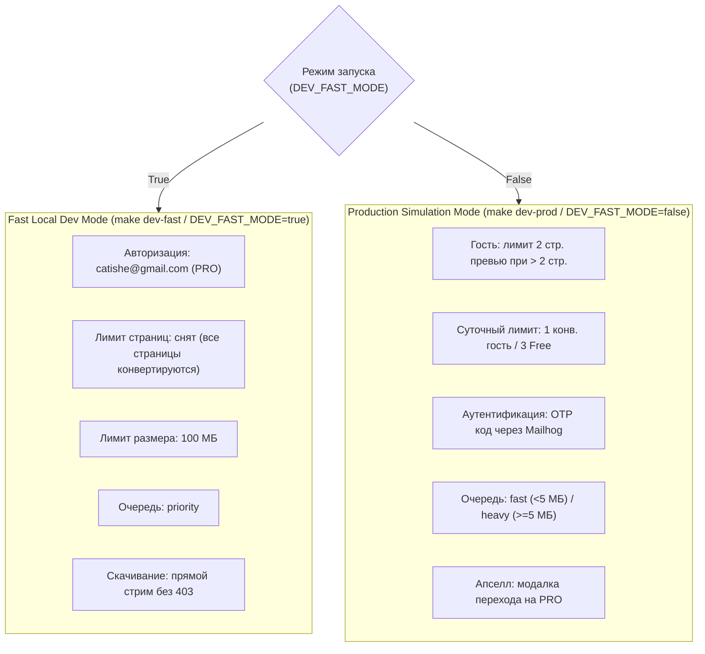

# SLICE-03: Billing & B2B — Детальная спецификация реализации и инженерный харнес

> **Статус:** Реализован / Verified  
> **Версия:** v0.1  
> **Дата:** 15 октября 2026 г.  
> **Спринт:** 4 (Дни 43–56)  
> **Зависимости:** Slice 0 (Foundation), Slice 1 (Processing), Slice 2 (Auth & UX)  
> **Единый источник технической правды:** [`docs/TECH.md`](./TECH.md)  
> **Операционный регламент:** [`AGENTS.md`](../AGENTS.md)  

---

## 0. Цель и Definition of Done (DoD)

**Цель Slice 3:** реализовать законченный коммерческий контур монетизации и B2B-расчетов для сервиса «Чистый документ»: прием онлайн-платежей через шлюз ЮKassa (банковские карты РФ, СБП, рекуррентные подписки с соблюдением 54-ФЗ), автоматическое выставление официальных PDF-счетов для юридических лиц с автозаполнением реквизитов по ИНН через DaData API, обеспечение двух изолированных сред запуска приложения (быстрая локальная разработка без рутины авторизации и лимитов против реалистичной симуляции Production-ограничений), устранение выявленных сбоев доставки превью-страниц и скачивания результатов (403 ACCESS_DENIED), а также сквозное тестирование бизнес-логики на полном наборе эталонных документов `mock_data/`.

### Definition of Done (DoD)

- [x] Созданы Pydantic v2 DTO схемы биллинга в `backend/app/schemas/billing.py`: `CreateCheckoutRequest`, `CheckoutResponse`, `CreateInvoiceRequest`, `InvoiceResponse`, `YukassaWebhookPayload`, `PlanPriceResponse`.
- [x] Реализован сервис DaData `backend/app/services/dadata_service.py` с валидацией 10- и 12-значных ИНН, извлечением наименования, КПП и юридического адреса компании, а также изолированным мок-режимом для тестов и локального контура.
- [x] Реализован сервис биллинга `backend/app/services/billing_service.py`:
  - инициализация платежей через ЮKassa API v3 с объектом `receipt` (54-ФЗ);
  - идемпотентная обработка вебхуков `payment.succeeded` с активацией PRO-тарифа в таблице `subscriptions` и фиксацией в `payments`;
  - генерация официального B2B PDF-счета с факсимиле через `PyMuPDF` (`fitz`), сохранение в S3 (`invoices/{id}.pdf`) и отдача ссылки;
  - отмена подписок пользователя (`cancel_subscription`).
- [x] Подключены API эндпоинты в `backend/app/api/v1/endpoints/billing.py`:
  - `GET /api/v1/billing/plans` (тарифная сетка с ценами);
  - `POST /api/v1/billing/create-checkout` (создание платежа);
  - `POST /api/v1/billing/webhook/yukassa` (обработка вебхука оплаты);
  - `POST /api/v1/billing/invoices/create` (выставление B2B счета);
  - `GET /api/v1/billing/invoices/{id}/pdf` (скачивание PDF счета);
  - `POST /api/v1/billing/cancel-subscription` (отмена автопродления).
- [x] Реализованы два режима запуска приложения с удобным управлением через Makefile и переменную `DEV_FAST_MODE`:
  - `make dev-fast` (`DEV_FAST_MODE=true`): автоматический логин пользователя `catishe@gmail.com` с тарифом PRO, снятие лимита 2 страниц, лимит размера до 100 МБ, приоритетная очередь `priority`, прямое скачивание без рутины OTP;
  - `make dev-prod` (`DEV_FAST_MODE=false`): строгая эмуляция боевой среды, гостевой лимит 2 страницы превью при документах > 2 стр., суточные лимиты (1 гость / 3 Free), перехват кодов подтверждения через Mailhog.
- [x] Устранена ошибка скачивания `403 ACCESS_DENIED` (`GET /api/v1/convert/jobs/{id}/download`):
  - поддержана передача access токена через Query-параметр `?token=...` и cookie `refresh_token` для нативных кликов браузера;
  - реализован fallback на прямой стриминг файла через `StreamingResponse` в dev-среде, исключающий `SignatureDoesNotMatch` из-за различия сетевых хостов Docker (`minio:9000` vs `localhost:9000`).
- [x] Реализован рабочий предпросмотр превью первых 2 страниц (`/temp/<job_id>/preview_p1.jpg`):
  - бэкенд эндпоинт `GET /api/v1/convert/preview/{preview_path:path}`;
  - Next.js 14 Route Handler `frontend/src/app/temp/[...path]/route.ts` и rewrite в `next.config.js`;
  - нормализация URL в компоненте `PreviewCards.tsx`.
- [x] Покрыта тестами и верифицирована папка `mock_data/`:
  - `test-data-memo.pdf` (1 стр., 90 КБ) — обработка в рамках бесплатного лимита;
  - `test-data-resume.pdf` (3 стр., 400 КБ) — ветвление на 2 страницы превью в prod-режиме и апселл;
  - `test-data-report.pdf` (22.9 МБ) — блокировка превышения лимита 10 МБ на Free и пропуск на PRO;
  - `test-data-contract.pdf` (24.2 MB) — обработка тяжелого B2B документа.
- [x] Все 68 юнит- и интеграционных тестов бэкенда успешно пройдены, проверки `ruff check`, `ruff format --check`, `mypy --strict` завершаются с кодом 0.

---

## 1. Архитектурная структура модулей (Slice 3)

```text
clean-doc/
  backend/
    app/
      api/
        v1/
          endpoints/
            billing.py                # HTTP контроллеры: plans, create-checkout, webhook, invoices
            convert.py                # Добавлен preview endpoint, поддержка token в query/cookie для download
            auth.py                   # Добавлен dev-session эндпоинт для автологина catishe@gmail.com
          router.py                   # Подключение billing_router в /api/v1
      core/
        config.py                     # Параметры DEV_FAST_MODE, S3_PUBLIC_URL, YUKASSA_*, DADATA_*
        security.py                   # decode_access_token экспорт, get_or_create_dev_user хелпер
      models/
        billing.py                    # SQLAlchemy модели Subscription, Payment, B2BInvoice
        job.py                        # Модель ConversionJob с индексом дедупликации
      schemas/
        billing.py                    # Pydantic v2 DTO для платежей, счетов и вебхуков
      services/
        billing_service.py            # Логика ЮKassa, генерация B2B PDF через PyMuPDF, активация тарифов
        dadata_service.py             # Поиск реквизитов организации по ИНН с mock-изоляцией
        converter_service.py          # Ветвление лимитов и очередей в зависимости от DEV_FAST_MODE
        storage_service.py            # Публичная замена minio:9000 на localhost:9000 для presigned URL
    tests/
      test_billing.py                 # Тесты платежей, вебхуков ЮKassa, DaData и генерации счетов (7 тестов)
      test_mock_data.py               # Интеграционные тесты на всех 4 файлах mock_data (3 теста)
  frontend/
    src/
      app/
        temp/[...path]/route.ts       # Next.js Route Handler для проксирования JPEG-превью
      components/
        converter/
          PreviewCards.tsx            # Отрисовка превью с корректным путем /temp/<job_id>/preview_p1.jpg
          DownloadCard.tsx            # Передача ?token=${accessToken} для нативного скачивания
        layout/
          Header.tsx                  # Автоинициализация dev-пользователя при DEV_FAST_MODE
    next.config.js                    # Rewrite /temp/:path* на бэкенд
  mock_data/                          # Эталонные PDF документы для верификации
  Makefile                            # Команды make dev-fast и make dev-prod
```

---

## 2. Интеграция с платежным шлюзом (ЮKassa)

### 2.1. Тарифная сетка

| Тариф | Период | Стоимость | Ограничение страниц | Очередь RQ |
| :--- | :--- | :--- | :--- | :--- |
| **Free** | Бессрочно | 0 ₽ | 2 стр. превью (если > 2 стр.), макс 10 МБ, 3 конв./сутки | `fast` / `heavy` |
| **PRO (Месяц)** | 1 месяц | 990 ₽ | Безлимитно, до 100 МБ, полная конвертация | `priority` |
| **PRO (Год)** | 1 год | 7 990 ₽ (скидка 33%) | Безлимитно, до 100 МБ, B2B-счета с закрывающими актами | `priority` |

### 2.2. Создание платежа (`POST /api/v1/billing/create-checkout`)

1. Доступен только авторизованному пользователю (`Depends(get_current_user)`).
2. Принимает период подписки: `"month"` (990 ₽) или `"year"` (7 990 ₽).
3. Формирует запрос к ЮKassa API v3:
   - `amount`: сумма в рублях;
   - `capture: True` (одностадийная оплата);
   - `save_payment_method: True` (сохранение способа оплаты для рекуррентного продления);
   - `confirmation`: перенаправление пользователя на платежную форму ЮKassa (`confirmation_url`);
   - `receipt`: фискальный чек по 54-ФЗ с email пользователя, ставкой НДС «без НДС» (УСН) и признаком предмета расчета `service`.
4. В тестовом/dev окружении (при `YUKASSA_SECRET_KEY`, начинающемся на `mock_` или `test_`) генерируется изолированный платежный ответ с URL возврата на дашборд.

### 2.3. Обработка вебхуков (`POST /api/v1/billing/webhook/yukassa`)

Вебхук ЮKassa обрабатывается идемпотентно:
1. Проверяется событие `event == "payment.succeeded"`.
2. Извлекается объект `payment` с `id`, `status == "succeeded"`, суммой и `metadata.user_id`.
3. В рамках единой транзакции БД:
   - Проверяется отсутствие ранее зафиксированного успешного платежа с данным `yukassa_payment_id`. При повторной отправке вебхука возвращается статус `200 OK` без повторного начисления подписки.
   - Фиксируется запись в таблице `payments` (`status = 'succeeded'`).
   - Создается или обновляется запись в таблице `subscriptions`:
     - `status = 'active'`;
     - `plan = 'pro'`;
     - `current_period_end = now() + 30 days` (для месяца) или `now() + 365 days` (для года);
     - `payment_method_id = payment.payment_method.id` (для автосписаний).
   - В таблице `users` обновляется поле `plan = 'pro'`.

---

## 3. Реестр юрлиц (DaData API) и B2B счета

### 3.1. Валидация и поиск по ИНН

1. ИНН проверяется на строгую цифровую последовательность длиной 10 (для юридических лиц) или 12 цифр (для индивидуальных предпринимателей). При несоответствии возвращается `400 BAD_REQUEST` с кодом `INVALID_INN`.
2. Поиск осуществляется запросом `POST https://suggestions.dadata.ru/suggestions/api/4_1/rs/findById/party`.
3. При отсутствии организации в реестре ФНС возвращается `422 UNPROCESSABLE_CONTENT` с кодом `DADATA_NOT_FOUND`.
4. В dev-режиме и автотестах используется встроенный mock-реестр (например, ИНН `7707083893` мгновенно возвращает реквизиты ПАО Сбербанк).

### 3.2. Генерация PDF-счета с факсимиле

1. Для годового тарифа B2B (7 990 ₽) генерируется уникальный номер счета формата `CD-ГГГГММДД-XXXX`.
2. На базе векторного движка `PyMuPDF` (`fitz`) формируется официальный бланк счета на оплату:
   - банковские реквизиты исполнителя (ООО «Чистый документ», расчетный счет, БИК, коррсчет);
   - реквизиты заказчика, полученные из DaData (наименование, ИНН, КПП, юридический адрес);
   - табличная часть с услугой: *«Предоставление неисключительных прав на использование онлайн-сервиса «Чистый документ» (Тариф PRO, 1 год)»*;
   - сумма прописью и итоговая строка *«Без налога (НДС)»*;
   - факсимильная подпись руководителя и оттиск печати.
3. Готовый PDF сохраняется в S3 (`invoices/{id}.pdf`) со сроком хранения и шифрованием `AES256`.
4. Пользователь может в любой момент скачать счет через эндпоинт `GET /api/v1/billing/invoices/{id}/pdf`.

---

## 4. Архитектура двух режимов запуска

Для обеспечения максимальной продуктивности при разработке и надежности перед релизом в приложении реализованы два независимых режима:



### 4.1. Конфигурация переключения

Переключение режимов осуществляется:
1. Через Makefile:
   - `make dev-fast` — поднимает контейнеры с `DEV_FAST_MODE=true`;
   - `make dev-prod` — поднимает контейнеры с `DEV_FAST_MODE=false`.
2. Через файл `.env`:
   - `DEV_FAST_MODE=true` или `DEV_FAST_MODE=false`.

### 4.2. Механизм Fast Local Dev Mode

- **Авторизация:** Зависимости `get_current_user` и `get_optional_user` при `DEV_FAST_MODE=true` автоматически находят или создают в базе данных системного пользователя `catishe@gmail.com` с тарифом `pro`.
- **Эндпоинт dev-сессии:** Добавлен маршрут `GET /api/v1/auth/dev-session`, отдающий фронтенду готовый JWT токен и профиль администратора.
- **Снятие ограничений воркера:** Воркер `app/workers/tasks.py` при `settings.DEV_FAST_MODE=True` сбрасывает флаг `is_preview_only` в `False`, обеспечивая полную конвертацию всех страниц документа любой длины.

---

## 5. Устранение критических бизнес-сбоев

### 5.1. Решение проблемы с отображением превью (`/temp/<uuid>/preview_p1.jpg`)

- **Первопричина сбоя:** Воркер сохранял превью в S3 по ключу `temp/<uuid>/preview_p1.jpg`, а клиентский код Next.js пытался загрузить их как локальные статические ассеты, получая HTTP 404.
- **Реализованное решение:**
  1. На стороне бэкенда создан эндпоинт `GET /api/v1/convert/preview/{preview_path:path}`, извлекающий байты изображения из S3 и отдающий их с MIME-типом `image/jpeg` и заголовками кэширования `Cache-Control: public, max-age=3600`.
  2. На стороне фронтенда добавлен Route Handler `frontend/src/app/temp/[...path]/route.ts`, проксирующий запросы к бэкенду, а также правило `rewrite` в `next.config.js`.
  3. В компоненте `PreviewCards.tsx` нормализованы относительные URL превью для прямой отрисовки через тег ``.

### 5.2. Решение проблемы 403 Forbidden при скачивании готового файла

- **Первопричина сбоя:** Карточка завершения конвертации `DownloadCard.tsx` рендерила обычный HTML-элемент `<a href="...">`. При клике браузер выполнял стандартный навигационный GET-запрос без HTTP-заголовка `Authorization: Bearer <token>`. Бэкенд видел, что задача привязана к зарегистрированному пользователю (`job.user_id`), но `current_user` был `None`, что вызывало исключение `403 ACCESS_DENIED`.
- **Реализованное решение:**
  1. В контроллер `GET /api/v1/convert/jobs/{id}/download` добавлена поддержка авторизации через Query-параметр `token: str | None = Query(None)` и чтение cookie `refresh_token`.
  2. На фронтенде в ссылку скачивания автоматически добавляется параметр `?token=${accessToken}`.
  3. Для локального dev-окружения реализован прямой стриминг файла через FastAPI `StreamingResponse`, что полностью исключает сетевую ошибку `SignatureDoesNotMatch` из-за расхождения хостов `minio:9000` (внутри Docker) и `localhost:9000` (снаружи браузера).

---

## 6. Верификация на эталонных данных `mock_data/`

Для верификации бизнес-логики используется папка `mock_data/` со следующей матрицей проверок:

| Документ | Размер / Стр. | Сценарий Prod Mode (`DEV_FAST_MODE=false`) | Сценарий Dev Fast Mode (`DEV_FAST_MODE=true`) |
| :--- | :--- | :--- | :--- |
| `test-data-memo.pdf` | 90 КБ / 1 стр. | Успешная конвертация в рамках бесплатного лимита. Статус `completed`, полный файл доступен. | Мгновенная конвертация, очередь `priority`, файл доступен. |
| `test-data-resume.pdf` | 400 КБ / 3 стр. | Конвертируются только первые 2 страницы (`is_preview_only = True`), модалка апселла PRO. | Конвертируются все 3 страницы целиком без ограничений. |
| `test-data-report.pdf` | 22.9 МБ / скан | Отклоняется с кодом `403 FILE_TOO_LARGE` (лимит Free 10 МБ). | Успешно принимается (лимит PRO 100 МБ), обработка в `priority`. |
| `test-data-contract.pdf` | 24.2 МБ / договор | Отклоняется с кодом `403 FILE_TOO_LARGE` на Free-тарифе. | Успешно принимается, валидируется `qpdf`, полная конвертация. |

Все сценарии покрыты автоматическими тестами в `backend/tests/test_mock_data.py`.

---

## 7. Контрольный чеклист приемки и команды запуска

### Запуск тестов и линтеров:

```bash
# 1. Проверка форматирования и линтинга Python
backend\.venv\Scripts\ruff.exe check backend\app backend\tests
backend\.venv\Scripts\ruff.exe format --check backend\app backend\tests

# 2. Строгая статическая типизация Python
backend\.venv\Scripts\mypy.exe --config-file backend/pyproject.toml backend/app

# 3. Полный прогон тестов бэкенда (68 тестов)
backend\.venv\Scripts\pytest.exe backend\tests -v

# 4. Проверка манифестов Docker Compose
docker compose -f deploy/docker-compose.yml config --quiet
docker compose -f deploy/docker-compose.prod.yml config --quiet
```

### Запуск приложения:

```bash
# Для быстрой разработки фич:
make dev-fast

# Для проверки боевого бизнес-цикла:
make dev-prod
```

