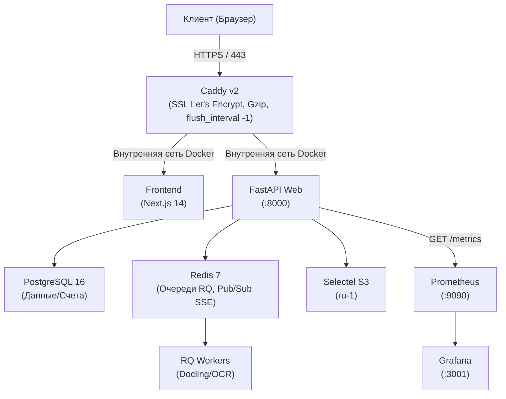

# Техническая спецификация проекта «Чистый документ»

> **Статус документа:** Действующий / Single Source of Truth
> **Версия:** v0.2
> **Дата фиксации:** 14 октября 2026 г.
> **Домен проекта:** `clean-doc.ru` / `чистыйдокумент.рф`
> **Язык спецификации:** Русский (технические идентификаторы, схемы БД, OpenAPI, переменные окружения и логи — на английском языке)

---

## 0. Как читать этот документ

Настоящий документ является исчерпывающей технической спецификацией (Single Source of Truth) архитектуры, протоколов взаимодействия, моделей данных и процесса разработки микро-SaaS сервиса **«Чистый документ»**.

1. **Обязательность следования:** Любая разработка в репозитории ведется в строгом соответствии с контрактами, зафиксированными в разделах 4, 5, 6, 7 и 8.
2. **Принцип неизменяемости контрактов:** Никакие неявные поля, временные заглушки, недекларированные HTTP-заголовки или модифицированные типы данных не допускаются без прохождения процедуры **CONTRACT GAP** (см. [`AGENTS.md`](../AGENTS.md)).
3. **Разделение ответственности:**
   - Разделы 1–3 фиксируют контекст продукта, архитектурный стек и структуру репозитория.
   - Разделы 4–7 задают жесткие контракты данных: схемы БД (PostgreSQL), публичный REST API (FastAPI), Server-Sent Events (SSE) для статуса задач и очереди RQ.
   - Разделы 8–10 описывают интеграции (Selectel S3 / MinIO, ЮKassa, DaData, Telegram), архитектуру фронтенда (Next.js 14 App Router) и инфраструктурный контур (Docker Compose, Caddy).
   - Разделы 11–13 регламентируют правила качества (тестирование, линтинг, гейты) и план реализации на 6 двухнедельных спринтов (90 дней).

---

## 1. Продукт

### 1.1. Назначение и бизнес-цель

**«Чистый документ»** — российский B2B/SMB микро-SaaS сервис конвертации PDF-документов в редактируемые форматы Word (`.docx`) и Excel (`.xlsx`) с сохранением структуры страниц, многоколоночной верстки и сложных таблиц.

Сервис решает проблему «съехавшей» верстки и испорченных таблиц после конвертации сканов, актов, счетов, отчетов из 1C и договоров. В отличие от зарубежных сервисов (iLovePDF, Smallpdf, Adobe Cloud), «Чистый документ» полностью локализован в РФ, строго соблюдает требования 152-ФЗ «О персональных данных», принимает оплату картами «Мир», через СБП и по безналичному расчету с предоставлением закрывающих документов (УПД).

**Цель MVP:** Создание полнофункционального рабочего сервиса за 90 дней (6 спринтов по 2 недели) с выходом на первых 10–20 платящих B2B-клиентов и доказательством сходимости юнит-экономики (маржинальность $\ge 90\%$).

### 1.2. Ограничения MVP

- Поддерживаются входные файлы строго формата PDF (MIME-тип `application/pdf`).
- Поддерживаются строго два формата экспорта: `docx` (Word) и `xlsx` (Excel).
- Максимальный размер файла:
  - Тариф Free: до 10 МБ, максимум 10 страниц на документ.
  - Тариф PRO / Бизнес: до 100 МБ, максимум 250 страниц на документ.
- Файлы хранятся во временном хранилище строго 2 часа с момента загрузки, после чего безвозвратно удаляются автоматической политикой S3 Lifecycle.
- Аутентификация без паролей: Telegram Login Widget + одноразовый Magic Link на Email (письмо содержит и кликабельную ссылку, и 6-значный числовой код — пользователь использует тот способ, который удобен).
- Сессия: access JWT хранится в памяти JS-клиента (Zustand store, 15 минут TTL); refresh token — в `HttpOnly; Secure; SameSite=Strict` cookie (7 дней TTL). Обновление access токена происходит автоматически через `/auth/refresh`.
- Оплата: ЮKassa (карты РФ, СБП, рекуррент) для физлиц и ИП; генерация PDF-счета с автозаполнением реквизитов по ИНН через DaData для юрлиц.

### 1.3. Границы функциональности (Out of Scope для MVP)

- Встроенный веб-редактор текста внутри браузера (выдача результата производится только в виде готового файла на скачивание).
- Мобильные нативные приложения (iOS / Android) — только адаптивная веб-версия.
- Командные аккаунты с разграничением ролей (Multi-seat RBAC). Один аккаунт = один вход.
- Прямая интеграция с 1С через SOAP/COM (доступна интеграция только через REST API в тарифе PRO — токены генерируются в личном кабинете через таблицу `app_tokens`, добавляется в Slice 3).
- Зарубежные платежные шлюзы (Stripe, PayPal) — продукт ориентирован строго на рынок РФ и СНГ.

### 1.4. Тарифная сетка

| Параметр | Тариф Free | Тариф PRO / Бизнес |
| :--- | :--- | :--- |
| **Стоимость** | 0 ₽ | 1 490 ₽/мес или 11 900 ₽/год |
| **Лимит файлов** | 3 конвертации в день (1 анонимно + 2 после логина) | Без ограничений (до 500 в день по fair use) |
| **Максимальный размер** | До 10 МБ | До 100 МБ |
| **OCR (распознавание сканов)** | Нет (только превью первых 2 страниц) | Полный OCR на базе встроенного движка Docling (EasyOCR + Tesseract) |
| **Многостраничные файлы** | Полное скачивание до 2 страниц (далее превью) | Без ограничений (до 250 страниц) |
| **Приоритет в очереди** | Стандартный (очередь `fast`/`heavy`) | Высокий (приоритетная очередь `priority`) |
| **Оплата для юрлиц** | Недоступно | Оплата по счету от ИП/ООО, закрывающие акты |
| **Срок хранения файлов** | 2 часа | 2 часа |

### 1.5. Ключевые пользовательские сценарии (E2E Scenarios)

1. **Анонимная первая конвертация (WOW-эффект):** Гость заходит на сайт, перетаскивает PDF-документ (до 10 МБ). Файл загружается, система запускает конвертацию и через 5–10 секунд показывает интерактивное превью первых 2 страниц и кнопку скачивания готового DOCX/XLSX.
2. **Активация лимита Free-тарифа (Passwordless):** При попытке выполнить 2-ю конвертацию гостю предлагается войти через Telegram или ввести Email для получения ссылки/кода. После входа лимит пополняется до 3 конвертаций на текущие сутки.
3. **Апселл при многостраничном файле / скане:** Пользователь загружает PDF на 20 страниц или скан без текстового слоя. Система бесплатно конвертирует и отображает первые 2 страницы в превьювере, а на кнопку «Скачать весь документ» выводит модальное окно перехода на тариф PRO (1 490 ₽).
4. **Оплата картой / СБП (ЮKassa):** Пользователь нажимает «Оформить PRO», перенаправляется на шлюз ЮKassa, платит через СБП или карту «Мир». Webhook подтверждает оплату, статус обновляется в реальном времени через SSE, скачивание полного документа стартует автоматически.
5. **Оплата по счету для юрлиц (B2B):** Бухгалтер выбирает годовой тариф «Оплата по счету», вводит ИНН компании. Бэкенд запрашивает DaData API, формирует PDF-счет с факсимиле и реквизитами. После зачисления средств (или загрузки платежки) аккаунту активируется статус PRO.

---

## 2. Стек технологий

| Компонент / Слой | Технология | Версия | Обоснование выбора |
| :--- | :--- | :--- | :--- |
| **Backend Framework** | Python / FastAPI | Python 3.12+, FastAPI 0.115+ | Асинхронный высокопроизводительный фреймворк, встроенная валидация Pydantic v2, автогенерация схемы OpenAPI 3.1. |
| **Очереди задач** | RQ (Redis Queue) | RQ 2.0+, Redis 7.2+ | Легковесная чисто питоновская очередь без избыточности Celery, простая изоляция процессов воркеров. |
| **Движок парсинга PDF** | Docling + PyMuPDF | Docling 2.0+, PyMuPDF 1.24+ | State-of-the-art сохранение табличной верстки и колонок по координатным сеткам. |
| **OCR модуль** | Docling (встроенный EasyOCR + Tesseract) | Docling 2.0+ | Docling 2.0 включает встроенную OCR-цепочку (EasyOCR/Tesseract), отдельный PaddleOCR не требуется. Снижает вес Docker-образа воркера на ~1.5 ГБ. |
| **Нарезка превью** | `qpdf` CLI | qpdf 11+ | Молниеносная нарезка первых 2 страниц без расхода оперативной памяти Python. |
| **СУБД** | PostgreSQL | 16 | Реляционная целостность, поддержка UUIDv4, транзакции для биллинга и счетов. |
| **Миграции БД** | Alembic | 1.13+ | Стандарт версионирования схемы базы данных для Python. |
| **Объектное хранилище** | Selectel S3 (Prod) / MinIO (Dev) | S3 API (ru-1 Selectel) | 100% размещение в РФ (ФЗ-152), автоматические правила Lifecycle для удаления файлов через 2 часа. Локально — MinIO в Docker. |
| **Транспорт статуса** | Server-Sent Events (SSE) | EventSource API | Однонаправленный стриминг статуса конвертации поверх HTTP/2 без накладных расходов WebSocket. |
| **Frontend Framework** | Next.js 14 (App Router) | Next.js 14.2+, React 18/19 | SSR для SEO-продвижения посадочных страниц, легкие клиентские интерактивные компоненты. |
| **Стилизация фронтенда** | Tailwind CSS + shadcn/ui | Tailwind 3.4+ | Минималистичный, строгий B2B-дизайн без визуального шума. |
| **Состояние фронтенда** | Zustand + TanStack Query | Zustand 4+, Query 5+ | Zustand для локального состояния загрузки; Query для сетевых запросов и кэша. |
| **Превью документов** | PDF.js | pdfjs-dist 4+ | Отрисовка страниц PDF в браузере через canvas/SVG. |
| **Платежный шлюз** | ЮKassa API v3 | REST API v3 | Рекуррентные подписки, СБП, карты «Мир», фискализация чеков по 54-ФЗ. |
| **B2B реквизиты** | DaData API | REST API | Автозаполнение наименования, КПП, ОГРН и адреса юрлица по одному ИНН. |
| **Веб-сервер / Прокси** | Caddy v2 | Caddy 2.8+ | Автоматический выпуск и продление SSL-сертификатов Let's Encrypt, TLS 1.3, обратный прокси к Uvicorn и Next.js. |
| **Пакетный менеджер** | `uv` (Astral) | uv 0.4+ | Сверхбыстрая установка зависимостей и детерминированная фиксация `uv.lock`. |
| **Rate Limiting** | `slowapi` | slowapi 0.1+ | Декораторный rate limiter поверх Starlette/FastAPI, хранит счетчики в Redis. Простая интеграция без кастомной сборки Caddy. |
| **Мониторинг** | Prometheus + Grafana | Prometheus 2.50+, Grafana 10+ | Метрики FastAPI через `prometheus-fastapi-instrumentator`; Grafana-дашборды в Docker Compose. |

---

## 3. Структура монорепозитория

```text
clean-doc/
  backend/
    app/
      api/
        v1/
          endpoints/
            auth.py               # Passwordless auth: Telegram & Magic link
            convert.py            # Upload, stream SSE, download results
            billing.py            # ЮKassa webhooks, invoices DaData, plans
            users.py              # User profile, conversion history
          router.py               # Объединение маршрутов API v1
      core/
        config.py                 # Pydantic Settings (.env парсер)
        database.py               # Пул asyncpg / SQLAlchemy async engine
        redis.py                  # Подключение Redis и Pub/Sub
        security.py               # JWT генерация и валидация токенов
      models/                     # SQLAlchemy 2.0 ORM декларации
        user.py
        job.py
        subscription.py
        invoice.py
        usage.py
      schemas/                    # Pydantic v2 DTO схемы запросов/ответов
        auth.py
        convert.py
        billing.py
        job.py
      services/                   # Изолированная бизнес-логика
        auth_service.py
        converter_service.py      # Координация Docling, qpdf и OCR
        storage_service.py        # S3 клиент aioboto3 (Selectel / MinIO)
        billing_service.py        # ЮKassa интеграция и автоподписки
        invoice_service.py        # DaData API и генерация счетов PDF
        cleanup_service.py        # Логика очистки устаревших записей
      workers/                    # Воркеры RQ
        worker.py                 # Точка входа RQ worker процесса
        tasks.py                  # Фоновые задачи: parse_and_convert, render_preview
      main.py                     # FastAPI приложение, lifespan, CORS, middleware
    alembic/                      # Миграции структуры PostgreSQL
      versions/
      env.py
    tests/                        # Тесты бэкенда
      conftest.py
      test_convert.py
      test_billing.py
      test_auth.py
    Dockerfile.api
    Dockerfile.worker
    pyproject.toml                # Конфигурация uv, ruff, mypy, pytest
    uv.lock
  frontend/
    src/
      app/                        # Next.js 14 App Router
        layout.tsx                # Корневой лэйаут, Inter шрифт, провайдеры
        page.tsx                  # Главный конвертер + Hero + SEO блок (/)
        pricing/
          page.tsx                # Тарифная сетка и заказ B2B счета (/pricing)
        dashboard/
          page.tsx                # Личный кабинет и история 24ч (/dashboard)
        auth/
          verify/page.tsx         # Обработка magic link токена
        terms/
          page.tsx                # Публичная оферта B2B/B2C
        privacy/
          page.tsx                # Политика 152-ФЗ
      components/
        converter/                # Drag-and-drop дропзона, превьювер PDF
          dropzone.tsx
          progress-bar.tsx
          preview-modal.tsx
          format-selector.tsx
        billing/                  # Модалка подписки, форма ИНН
          pricing-card.tsx
          invoice-modal.tsx
        ui/                       # shadcn/ui компоненты (button, dialog, toast)
      lib/
        api-client.ts             # Типизированный fetch-клиент
        sse-client.ts             # Обвязка EventSource для статуса
        types.ts                  # Сгенерированные типы OpenAPI
      store/
        useConverterStore.ts      # Zustand стор текущей задачи
        useUserStore.ts           # Данные сессии пользователя
    public/
    package.json
    tailwind.config.ts
    tsconfig.json
  deploy/
    docker-compose.yml            # Локальный стек (MinIO, Redis, Postgres, API, Worker)
    docker-compose.prod.yml       # Боевой стек для VDS
    Caddyfile                     # Конфигурация веб-сервера Caddy
  docs/
    TECH.md                       # Настоящий документ спецификации
    AGENTS.md                     # Регламент работы разработчиков и AI-агентов
  Makefile                        # Команды управления: make dev, make gate, make test
  README.md                       # Описание проекта на русском языке
  LICENSE                         # Лицензия
  .markdownlint.yml               # Конфигурация проверки документации
```

---

## 4. Контракты данных (Database Schema & Types)

СУБД: **PostgreSQL 16**. Все первичные ключи формируются как `UUID` через `gen_random_uuid()`. Время хранится строго в формате `TIMESTAMPTZ` в шкале UTC.

### 4.1. Схема PostgreSQL (DDL)

```sql
-- Включение генератора UUID
CREATE EXTENSION IF NOT EXISTS "pgcrypto";

-- Таблица пользователей
CREATE TABLE IF NOT EXISTS users (
    id UUID PRIMARY KEY DEFAULT gen_random_uuid(),
    email TEXT UNIQUE,
    telegram_id BIGINT UNIQUE,
    telegram_username TEXT,
    plan TEXT NOT NULL DEFAULT 'free' CHECK (plan IN ('free', 'pro')),
    created_at TIMESTAMPTZ NOT NULL DEFAULT NOW(),
    updated_at TIMESTAMPTZ NOT NULL DEFAULT NOW()
);

-- Таблица refresh-токенов (для беспарольной аутентификации)
-- Хранит SHA-256 хеш токена. Сам токен выдается клиенту в HttpOnly Cookie.
CREATE TABLE IF NOT EXISTS refresh_tokens (
    id UUID PRIMARY KEY DEFAULT gen_random_uuid(),
    user_id UUID NOT NULL REFERENCES users(id) ON DELETE CASCADE,
    token_hash TEXT NOT NULL UNIQUE,  -- SHA-256(raw_token)
    expires_at TIMESTAMPTZ NOT NULL,   -- NOW() + 7 days
    revoked BOOLEAN NOT NULL DEFAULT FALSE,
    created_at TIMESTAMPTZ NOT NULL DEFAULT NOW()
);

-- Таблица учета суточных конвертаций (для защиты Free-тарифа)
-- Правила идентификации анонимов:
--   1) если fingerprint не NULL — лимит по (fingerprint, ip_subnet, usage_date)
--   2) если fingerprint NULL (в редких случаях) — лимит по (ip_subnet, usage_date)
CREATE TABLE IF NOT EXISTS daily_usage (
    id UUID PRIMARY KEY DEFAULT gen_random_uuid(),
    user_id UUID REFERENCES users(id) ON DELETE CASCADE,  -- NULL для анонимов
    fingerprint TEXT,          -- client-side browser fingerprint (FingerprintJS)
    ip_subnet TEXT NOT NULL,   -- /24 подсеть (фолбэк, если fingerprint пустой)
    usage_date DATE NOT NULL DEFAULT CURRENT_DATE,
    conversion_count INT NOT NULL DEFAULT 1,
    created_at TIMESTAMPTZ NOT NULL DEFAULT NOW(),
    CONSTRAINT uq_daily_user UNIQUE(user_id, usage_date),
    CONSTRAINT uq_daily_guest UNIQUE(fingerprint, ip_subnet, usage_date)
);

-- Таблица задач конвертации
CREATE TABLE IF NOT EXISTS conversion_jobs (
    id UUID PRIMARY KEY DEFAULT gen_random_uuid(),
    user_id UUID REFERENCES users(id) ON DELETE SET NULL,
    target_format TEXT NOT NULL CHECK (target_format IN ('docx', 'xlsx')),
    original_filename TEXT NOT NULL,
    file_size_bytes BIGINT NOT NULL,
    page_count INT,
    status TEXT NOT NULL DEFAULT 'pending' CHECK (status IN ('pending', 'queued', 'processing', 'completed', 'failed')),
    s3_input_key TEXT NOT NULL,
    s3_output_key TEXT,
    s3_preview_keys JSONB DEFAULT '[]'::jsonb,
    error_message TEXT,
    is_preview_only BOOLEAN NOT NULL DEFAULT FALSE,
    processing_seconds NUMERIC(6, 2),
    created_at TIMESTAMPTZ NOT NULL DEFAULT NOW(),
    expires_at TIMESTAMPTZ NOT NULL DEFAULT (NOW() + INTERVAL '2 hours')
);

-- Таблица подписок (ЮKassa)
CREATE TABLE IF NOT EXISTS subscriptions (
    id UUID PRIMARY KEY DEFAULT gen_random_uuid(),
    user_id UUID NOT NULL REFERENCES users(id) ON DELETE CASCADE,
    plan TEXT NOT NULL CHECK (plan IN ('pro')),
    billing_period TEXT NOT NULL CHECK (billing_period IN ('month', 'year')),
    status TEXT NOT NULL DEFAULT 'active' CHECK (status IN ('active', 'past_due', 'cancelled')),
    yukassa_payment_id TEXT UNIQUE,           -- ID последнего платежа
    yukassa_payment_method_id TEXT,            -- для рекуррентных списаний
    amount_rub INT NOT NULL,
    current_period_start TIMESTAMPTZ NOT NULL DEFAULT NOW(),
    current_period_end TIMESTAMPTZ NOT NULL,
    next_billing_at TIMESTAMPTZ,               -- когда cron-воркер должен списать (= current_period_end - 1 час)
    retry_count INT NOT NULL DEFAULT 0,        -- счетчик повторных попыток при past_due (макс. 3)
    created_at TIMESTAMPTZ NOT NULL DEFAULT NOW()
);

-- Таблица счетов для юрлиц (B2B)
CREATE TABLE IF NOT EXISTS b2b_invoices (
    id UUID PRIMARY KEY DEFAULT gen_random_uuid(),
    user_id UUID NOT NULL REFERENCES users(id) ON DELETE CASCADE,
    invoice_number TEXT NOT NULL UNIQUE,
    inn TEXT NOT NULL,
    kpp TEXT,
    company_name TEXT NOT NULL,
    company_address TEXT NOT NULL,
    amount_rub INT NOT NULL,
    status TEXT NOT NULL DEFAULT 'pending' CHECK (status IN ('pending', 'paid', 'cancelled')),
    pdf_s3_key TEXT NOT NULL,
    paid_at TIMESTAMPTZ,
    created_at TIMESTAMPTZ NOT NULL DEFAULT NOW()
);

-- Таблица API-токенов (для интеграции PRO через REST API, Slice 3)
CREATE TABLE IF NOT EXISTS app_tokens (
    id UUID PRIMARY KEY DEFAULT gen_random_uuid(),
    user_id UUID NOT NULL REFERENCES users(id) ON DELETE CASCADE,
    name TEXT NOT NULL,                        -- пользовательское название ("Мой 1С-клиент")
    token_hash TEXT NOT NULL UNIQUE,           -- SHA-256(raw_token), raw выдается один раз
    scopes TEXT[] NOT NULL DEFAULT '{convert}', -- набор разрешений: 'convert', 'status'
    last_used_at TIMESTAMPTZ,
    expires_at TIMESTAMPTZ,                    -- NULL = бессрочный
    revoked BOOLEAN NOT NULL DEFAULT FALSE,
    created_at TIMESTAMPTZ NOT NULL DEFAULT NOW()
);

-- Индексы производительности
CREATE INDEX IF NOT EXISTS idx_users_email ON users(email);
CREATE INDEX IF NOT EXISTS idx_users_telegram ON users(telegram_id);
CREATE INDEX IF NOT EXISTS idx_jobs_user_status ON conversion_jobs(user_id, status);
CREATE INDEX IF NOT EXISTS idx_jobs_expires ON conversion_jobs(expires_at) WHERE status = 'completed';
CREATE INDEX IF NOT EXISTS idx_daily_usage_date ON daily_usage(usage_date);
CREATE INDEX IF NOT EXISTS idx_subscriptions_user ON subscriptions(user_id, status);
CREATE INDEX IF NOT EXISTS idx_subscriptions_billing ON subscriptions(next_billing_at) WHERE status IN ('active', 'past_due');
CREATE INDEX IF NOT EXISTS idx_invoices_user ON b2b_invoices(user_id, status);
CREATE INDEX IF NOT EXISTS idx_refresh_tokens_hash ON refresh_tokens(token_hash) WHERE revoked = FALSE;
CREATE INDEX IF NOT EXISTS idx_app_tokens_hash ON app_tokens(token_hash) WHERE revoked = FALSE;
```

### 4.2. Pydantic v2 схемы (Бэкенд модели)

```python
from datetime import datetime
from typing import Literal, Optional
from uuid import UUID
from pydantic import BaseModel, Field, EmailStr

class UserBase(BaseModel):
    id: UUID
    email: Optional[EmailStr] = None
    telegram_id: Optional[int] = None
    telegram_username: Optional[str] = None
    plan: Literal["free", "pro"]
    created_at: datetime

class ConvertInitRequest(BaseModel):
    target_format: Literal["docx", "xlsx"]
    fingerprint: Optional[str] = Field(None, max_length=128)

class JobStatusResponse(BaseModel):
    id: UUID
    status: Literal["pending", "queued", "processing", "completed", "failed"]
    progress_percent: int = Field(0, ge=0, le=100)
    current_step: str
    original_filename: str
    target_format: Literal["docx", "xlsx"]
    page_count: Optional[int] = None
    is_preview_only: bool = False
    preview_urls: list[str] = Field(default_factory=list)
    download_url: Optional[str] = None
    error_message: Optional[str] = None
    expires_at: datetime

class CreateInvoiceRequest(BaseModel):
    inn: str = Field(..., min_length=10, max_length=12, pattern=r"^\d{10}(\d{2})?$")
    billing_period: Literal["year"] = "year"

class InvoiceResponse(BaseModel):
    id: UUID
    invoice_number: str
    company_name: str
    amount_rub: int
    pdf_download_url: str
    status: Literal["pending", "paid", "cancelled"]
    created_at: datetime
```

### 4.3. TypeScript интерфейсы (Frontend)

```typescript
export type TargetFormat = 'docx' | 'xlsx';
export type JobStatus = 'pending' | 'queued' | 'processing' | 'completed' | 'failed';
export type UserPlan = 'free' | 'pro';

export interface UserProfile {
  id: string;
  email: string | null;
  telegram_username: string | null;
  plan: UserPlan;
  conversions_today: number;
  conversions_limit: number;
}

export interface JobProgressEvent {
  job_id: string;
  status: JobStatus;
  progress_percent: number;
  current_step: string;
  page_current?: number;
  page_total?: number;
  preview_urls?: string[];
  download_url?: string | null;
  is_preview_only?: boolean;
  error?: string | null;
}

export interface ApiError {
  error: string;
  code: string;
  upgrade_url?: string;
}
```

---

## 5. Контракты API (REST + Server-Sent Events)

Базовый префикс всех эндпоинтов: `/api/v1`.

### 5.1. Аутентификация (`/api/v1/auth`)

| Метод | Путь | Описание | Доступ |
| :--- | :--- | :--- | :--- |
| `POST` | `/auth/magic-link` | Запрос письма с Magic Link и 6-значным кодом | Публичный |
| `POST` | `/auth/verify-code` | Подтверждение кода или токена из ссылки; выдает access JWT + refresh cookie | Публичный |
| `POST` | `/auth/telegram` | Авторизация через Telegram Login Widget хэш; выдает access JWT + refresh cookie | Публичный |
| `POST` | `/auth/refresh` | Обновление access JWT по refresh cookie; выдает новый access JWT | Публичный |
| `POST` | `/auth/logout` | Отзыв refresh token в БД, сброс HttpOnly cookie | Авторизованный |
| `GET` | `/auth/me` | Получение профиля текущего пользователя | Авторизованный |

### 5.2. Конвертация файлов (`/api/v1/convert`)

#### 1. Загрузка файла и инициализация: `POST /convert/upload`

- **Content-Type:** `multipart/form-data`
- **Поля формы:**
  - `file`: бинарные данные PDF (валидация Magic Bytes `%PDF-`).
  - `target_format`: строка `docx` или `xlsx`.
  - `fingerprint`: опциональная строка отпечатка браузера.
- **Ответ при успехе (202 Accepted):**

```json
{
  "job_id": "8fa8b7d2-7c3e-4b42-9a5c-7b2a59a72190",
  "status": "queued",
  "stream_url": "/api/v1/convert/jobs/8fa8b7d2-7c3e-4b42-9a5c-7b2a59a72190/stream"
}
```

#### 2. Real-time стриминг прогресса: `GET /convert/jobs/{job_id}/stream`

- **Протокол:** Server-Sent Events (`text/event-stream`).
- **Заголовки ответа:** `Cache-Control: no-cache`, `Connection: keep-alive`, `Flush: true` (Caddy-директива: `flush_interval -1` в Caddyfile для upstream FastAPI).
- **Механизм push:** воркер публикует обновления через `Redis PUBLISH job:{job_id}:progress <json>`; SSE-хендлер подписывается через `SUBSCRIBE` и пересылает сообщения клиенту.
- **Формат сообщений SSE:**

```text
event: progress
data: {"job_id":"8fa8b7d2-7c3e-4b42-9a5c-7b2a59a72190","status":"processing","progress_percent":45,"current_step":"Анализ табличной структуры (стр. 3 из 8)","page_current":3,"page_total":8}

event: complete
data: {"job_id":"8fa8b7d2-7c3e-4b42-9a5c-7b2a59a72190","status":"completed","progress_percent":100,"current_step":"Готово к скачиванию","download_url":"/api/v1/convert/jobs/8fa8b7d2-7c3e-4b42-9a5c-7b2a59a72190/download","is_preview_only":false}
```

#### 3. Скачивание результата: `GET /convert/jobs/{job_id}/download`

- **Ответ:** Редирект `307 Temporary Redirect` на подписанный pre-signed S3 URL с ограниченным сроком жизни (15 минут) и заголовком `Content-Disposition: attachment; filename="document.docx"`.

### 5.3. Биллинг и B2B счета (`/api/v1/billing`)

| Метод | Путь | Описание | Формат тела |
| :--- | :--- | :--- | :--- |
| `POST` | `/billing/create-checkout` | Создание платежа ЮKassa (карты/СБП) | `{"billing_period": "month" \| "year"}` |
| `POST` | `/billing/webhook/yukassa` | Обработка вебхука от ЮKassa | JSON уведомления ЮKassa |
| `POST` | `/billing/invoices/create` | Выставление B2B счета по ИНН | `{"inn": "7707083893"}` |
| `GET` | `/billing/invoices/{id}/pdf` | Скачивание сгенерированного PDF счета | PDF поток |
| `POST` | `/billing/cancel-subscription` | Отмена автопродления подписки | Пустое тело |

---

## 6. Контракты очередей задач (Redis Queue / RQ)

Фоновая обработка изолирована в воркерах RQ.

### 6.1. Очереди

1. **Очередь `priority`:** Задачи пользователей с тарифом PRO. Обрабатываются в первую очередь.
2. **Очередь `fast`:** Документы до 5 страниц с текстовым слоем от Free-пользователей.
3. **Очередь `heavy`:** Документы со сканами, требующие OCR, и объемные пакеты страниц.

**Топология воркеров:** запускается **один** процесс `rq worker`, слушающий все 3 очереди по приоритету. В Slice 4 (нагрузочное тестирование) можно масштабировать до 2-3 реплик с разделением heavy отдельно.

### 6.2. Жизненный цикл воркера и защита от OOM

- Запуск воркера: `rq worker priority fast heavy --max-jobs=50`.
- Ограничение памяти в Docker: `mem_limit: 4g`.
- При достижении 50 задач процесс воркера мягко завершается, освобождая оперативную память ОС от фрагментаций PyTorch, и автоматически перезапускается Docker демоном (`restart: unless-stopped`).
- Максимальный таймаут задачи (`job_timeout`): 180 секунд. При превышении статус переводится в `failed` с ошибкой клиенту: *«Время обработки превышено. Документ слишком сложен для автоматической обработки»*.

---

## 7. Унифицированная обработка ошибок и тексты для пользователей

Все ошибки клиенту возвращаются в строгом формате JSON с русскоязычным понятным описанием:

```json
{
  "error": "Описание ошибки на русском языке",
  "code": "MACHINE_READABLE_CODE",
  "upgrade_url": "/pricing"
}
```

### Таблица кодов ошибок

| HTTP Код | Машинный код `code` | Текст ошибки для пользователя |
| :--- | :--- | :--- |
| **400** | `INVALID_FILE_TYPE` | «Поддерживаются только файлы формата PDF» |
| **400** | `CORRUPTED_PDF` | «Файл поврежден или защищен паролем. Снимите пароль перед загрузкой» |
| **400** | `INVALID_INN` | «Укажите корректный ИНН организации (10 или 12 цифр)» |
| **401** | `UNAUTHORIZED` | «Для продолжения необходимо войти в аккаунт» |
| **403** | `FREE_LIMIT_EXCEEDED` | «Дневной лимит бесплатных конвертаций исчерпан. Оформите тариф PRO для продолжения» |
| **403** | `FILE_TOO_LARGE` | «Размер файла превышает лимит вашего тарифа (макс. 10 МБ на бесплатном тарифе)» |
| **404** | `JOB_NOT_FOUND` | «Задача конвертации не найдена или срок хранения файла (2 часа) истек» |
| **422** | `DADATA_NOT_FOUND` | «Организация с таким ИНН не найдена в реестре ФНС» |
| **429** | `RATE_LIMIT_EXCEEDED` | «Слишком много запросов. Пожалуйста, подождите минуту» |
| **500** | `CONVERSION_FAILED` | «Не удалось распознать структуру документа. Попробуйте другой файл» |
| **503** | `SERVICE_OVERLOADED` | «Сервис временно перегружен. Ваша задача поставлена в очередь» |

---

## 8. Внешние интеграции

### 8.1. Объектное хранилище (S3)

- **Dev-контур:** Локальный MinIO (`http://localhost:9000`), бакет `cleandoc-dev`.
- **Prod-контур:** Selectel Object Storage (регион `ru-1`, `https://s3.storage.selcloud.ru`), бакет `cleandoc-prod`.
- **Lifecycle Policy:** В бакете активировано нативное правило: удаление всех объектов с префиксом `temp/` старше **2 часов**.
- **Шифрование:** Все объекты загружаются с заголовком шифрования на стороне сервера: `ServerSideEncryption='AES256'`.

### 8.2. Платежный шлюз (ЮKassa)

- Интеграция по протоколу API v3.
- Передача объекта `receipt` для соблюдения требований 54-ФЗ (чеки отправляются на email плательщика).
- **Валидация вебхука:** подпись проверяется через официальный `yukassa_sdk` (встроенная криптография SHA-256 HMAC). Самостоятельная реализация проверки запрещена.
- **Рекуррентные списания:** через `yukassa_payment_method_id`; cron-воркер (RQ Scheduler) запускает списание за 1 час до `next_billing_at`; при отказе статус → `past_due`, `retry_count` растет; после 3 попыток подписка переходит в `cancelled`.

### 8.3. Реестр юрлиц (DaData API)

- Используется метод `POST https://suggestions.dadata.ru/suggestions/api/4_1/rs/findById/party`.
- По ИНН за 200 мс извлекаются: полное наименование компании, КПП, ОГРН, юридический адрес и ФИО генерального директора.

### 8.4. Telegram

- **Login Widget:** вход пользователя через Telegram Login Widget (HMAC-SHA256 валидация полученных параметров).
- **Notification Bot (админ):** бот отправляет алерты в приватный чат админа (TELEGRAM_ADMIN_CHAT_ID): новый платящий пользователь, ошибка конвертации (job со статусом `failed`), высокая нагрузка очереди.

---

## 9. Архитектура клиентского приложения (Frontend)

- **Фреймворк:** Next.js 14 с парадигмой Server Components по умолчанию. Директива `'use client'` изолирована в интерактивных виджетах.
- **Адаптивность:** Полная поддержка мобильных экранов (`sm: 640px`, `md: 768px`, `lg: 1024px`).
- **Дизайн-система:** Строгая черно-бело-синяя палитра с акцентным цветом `#2563EB` (синий), скругления `rounded-xl`, шрифт Inter. Отсутствие рекламы, всплывающих баннеров и отвлекающих элементов.

---

## 10. Инфраструктура, безопасность и соответствие 152-ФЗ

### 10.1. Требования 152-ФЗ

1. **Статус оператора:** Сервис выступает **«Лицом, осуществляющим обработку персональных данных по поручению Оператора (клиента)»** согласно ч. 3 ст. 6 152-ФЗ.
2. **Локализация баз данных:** Все физические серверы и СУБД находятся в дата-центрах на территории РФ (Санкт-Петербург/Москва).
3. **Регламент безвозвратного стирания:** Файлы не сохраняются в постоянных архивах и гарантированно уничтожаются через 2 часа.
4. **Конфиденциальность логов:** Категорически запрещено записывать имена файлов клиентов и распознанный текст в stdout или логи Prometheus/Loki. В логи попадают только обезличенные UUID задач, размер файлов в байтах и время обработки.

### 10.2. Сетевая топология (Production Docker Compose)



---

## 11. Переменные окружения (`.env.example`)

```ini
# Системные настройки
ENVIRONMENT=prod
DEBUG=false
PROJECT_NAME="Чистый документ"
API_V1_STR="/api/v1"
SECRET_KEY=generate_random_64_char_hex_key
ALLOWED_HOSTS=["clean-doc.ru","api.clean-doc.ru"]

# PostgreSQL
POSTGRES_SERVER=postgres
POSTGRES_USER=cleandoc
POSTGRES_PASSWORD=secure_pg_password
POSTGRES_DB=cleandoc_db
POSTGRES_PORT=5432

# Redis
REDIS_HOST=redis
REDIS_PORT=6379
REDIS_DB=0

# Хранилище S3 (Selectel Prod / MinIO Dev)
S3_ENDPOINT_URL=https://s3.storage.selcloud.ru
S3_REGION=ru-1
S3_BUCKET_NAME=cleandoc-prod
S3_ACCESS_KEY_ID=selectel_access_key
S3_SECRET_ACCESS_KEY=selectel_secret_key

# ЮKassa
YUKASSA_SHOP_ID=your_shop_id
YUKASSA_SECRET_KEY=your_secret_key
YUKASSA_RETURN_URL=https://clean-doc.ru/dashboard

# DaData API
DADATA_API_KEY=your_dadata_api_key

# Telegram Bot (Login Widget + Notification Bot)
TELEGRAM_BOT_TOKEN=your_telegram_bot_token
TELEGRAM_BOT_USERNAME=CleanDocBot
TELEGRAM_ADMIN_CHAT_ID=your_admin_chat_id  # ID чата для админских алертов

# Email (SMTP для отправки Magic Link + 6-значного кода)
SMTP_HOST=smtp.yandex.ru
SMTP_PORT=465
SMTP_USER=no-reply@clean-doc.ru
SMTP_PASSWORD=secure_smtp_password
SMTP_FROM_EMAIL=no-reply@clean-doc.ru

# Prometheus
PROMETHEUS_ENABLED=true
```

---

## 12. Стандарты качества и процедура `make gate`

Каждый коммит и pull request валидируется единой командой:

```bash
make gate
```

Состав проверок:
1. **Markdown линтинг:** `markdownlint "**/*.md" --ignore node_modules`
2. **Python линтинг и форматирование:** `ruff check backend/ && ruff format --check backend/`
3. **Python статическая типизация:** `mypy --strict backend/app`
4. **Python тесты:** `pytest -v --cov=backend/app backend/tests`
5. **Frontend линтинг и тесты:** `cd frontend && npm run lint && npm run typecheck && npm run test && npm run build && cd ..`
6. **Docker-compose валидация:** `docker compose -f deploy/docker-compose.yml config --quiet`

---

## 13. План реализации по спринтам (90 дней / 6 спринтов)

| Спринт | Сроки | Срез (Slice) | Ключевые результаты (DoD) |
| :--- | :--- | :--- | :--- |
| **Спринт 1** | Дни 1–14 | **Slice 0: Foundation** | Монорепозиторий, `docker-compose.yml` (MinIO, Postgres, Redis), `make dev`, `make gate`, базовая модель БД, документация `docs/TECH.md` и `AGENTS.md`. |
| **Спринт 2** | Дни 15–28 | **Slice 1: Processing** | Интеграция `Docling`, `qpdf` превью, воркеры RQ, стриминг прогресса по SSE, валидация 20 тестовых PDF актов и таблиц. |
| **Спринт 3** | Дни 29–42 | **Slice 2: Auth & UX** | Интерфейс конвертера на Next.js 14, Passwordless вход (Telegram + Email), 3-слойная защита Free-тарифа, превью первых 2 страниц. |
| **Спринт 4** | Дни 43–56 | **Slice 3: Billing & B2B** | Интеграция ЮKassa (карты/СБП), DaData API для генерации счетов по ИНН, автоудаление файлов через 2 часа, оферта и 152-ФЗ. |
| **Спринт 5** | Дни 57–70 | **Slice 4: Deploy & Hardening** | Развертывание VDS (Selectel), SSL Caddy, Selectel S3, нагрузочное тестирование на 50 параллельных конвертаций, Яндекс.Метрика. |
| **Спринт 6** | Дни 71–90 | **Slice 5: Public Beta & Growth** | SEO-посадочные страницы, публикация кейса на VC.ru, привлечение первых 10–20 платящих B2B-клиентов, доводка юнит-экономики. |
